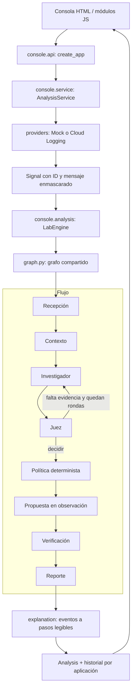

# Arquitectura de TiderOps

El [atlas editable de draw.io](diagrams/TiderOps_Arquitectura.drawio) desarrolla estas
responsabilidades en 13 páginas con referencias al código. La [guía](diagrams/README.md)
explica cada vista y la [galería visual](diagrams/index.html) conserva sus vistas previas.

## Recorrido de una solicitud

1. `AnalyzeRequest` valida servicio, fuente, escenario y ventana horaria. La misma
   validación se aplica desde HTTP y al invocar el servicio directamente.
2. `AnalysisService` obtiene las señales, asigna identificadores y llama al motor.
   Define los errores de consulta/análisis, la duración, el ID y el historial.
3. `EvidenceProvider` selecciona la fuente. El adaptador Cloud Logging recibe
   `Settings`, limita la consulta y enmascara los mensajes antes del diagnóstico.
4. `LabEngine` crea dependencias para esa ejecución: herramientas cerradas de
   lectura, contexto, modelo o baseline y una copia de la política del namespace.
5. `graph.py` declara los nodos y sus transiciones. Las funciones de agentes viven
   en `agents/`; las funciones de política/ejecución/verificación en `workflow/`.
6. `WorkflowResult` valida la salida del motor. `explanation.py` transforma los
   eventos registrados en `DecisionStep`; no realiza una segunda inferencia.
7. La API devuelve el resultado. La consola renderiza decisiones y referencias
   a las señales; el JSON completo queda disponible como detalle técnico.

## Responsabilidades y dependencias

| Área | Puede usar | No debe decidir |
|---|---|---|
| `static/js/api.js` | API HTTP | Diagnóstico, confianza o política |
| `static/js/render.js` | Resultado público y DOM | Qué resultado aprobar |
| `static/js/app.js` | Formulario, cliente HTTP y render | Interpretación de logs |
| `console/api.py` | Caso de uso y modelos | Hipótesis o ejecución del grafo |
| `console/service.py` | Contratos `EvidenceSource` y `DiagnosticEngine` | Reglas de RCA |
| `console/providers/` | Cliente externo o fixtures | Causa raíz del incidente |
| `console/analysis.py` | Motor compartido y configuración | Reescribir los agentes |
| `agents/` | Estado, herramientas y proveedor LLM | Ejecutar comandos libres |
| `decision/` | Hipótesis, veredicto y datos estructurados | Invocar un LLM |
| `executor/` | Adaptadores operativos acotados | Saltar la política |

`create_app()` es el punto de composición. Las pruebas inyectan proveedores y
motores mediante contratos pequeños. Configuración e historial pertenecen a una
instancia de aplicación; no hay un deque global compartido entre aplicaciones.
Cada análisis tiene herramientas, modelo programado y memoria de contexto propios.
El historial usa bloqueo y devuelve copias para evitar mutaciones accidentales.

## Cómo leer las decisiones

Cada paso expone `sequence`, `stage`, `title`, `outcome`, `reason`, `status` y
`evidence_ids`. Los IDs `S01…` pertenecen al resultado del incidente. Las referencias
indican señales consultadas; la relevancia de cada señal se evalúa en el diagnóstico.
No se presenta la lectura de una señal como prueba automática de causalidad.

En el baseline, Redis y Cart Service se identifican por patrones en señales de
error. Una coincidencia inequívoca recibe 0,7; señales normales, vacías o
contradictorias producen evidencia insuficiente. La puntuación es heurística.
El juez conserva sus controles deterministas: ausencia de telemetría → confianza
0; una sola clase de telemetría → tope de 0,7. La política decide la ruta final.

La auditoría conserva las rondas adicionales del investigador y juez, en orden.
Una etapa omitida aparece como `skipped`, por ejemplo la verificación cuando no
se ejecutó una acción. Los motivos se derivan del evento real, no del último estado
aplicado retroactivamente a todas las rondas.

## Dos entradas al mismo motor

- **Consola:** `python -m tider.console`, siempre `observation_only=True`. Devuelve
  propuestas, sin ejecutar remediaciones ni notificaciones externas.
- **Integración operativa:** `tider.api:app`, webhook autenticado de Alertmanager,
  con las credenciales, controles y ejecutores documentados en [engine.md](engine.md).

El punto de entrada local predeterminado es la consola. ChaosForge sigue siendo
responsable del laboratorio y de la inyección de fallos. E4 conserva su copia
histórica del prototipo y sus resultados; no es el paquete de ejecución actual.

## Añadir capacidades

- **Un escenario local:** añadir datos a `console/resources/scenarios.json`, ampliar
  el catálogo admitido en `AnalyzeRequest` y añadir un caso esperado en las pruebas.
  La etiqueta verdadera no se pasa al diagnóstico.
- **Una fuente de evidencia:** implementar el contrato `load(request)` o ampliar
  el gateway, devolver `Signal` y probar el filtrado, límites y errores con un
  cliente simulado. Las credenciales no pertenecen al resultado.
- **Un agente:** añadir su función en `agents/`, su prompt en `agents/prompts.py`,
  el estado correspondiente y las transiciones en `graph.py`.
- **Una regla de acción:** cambiar `decision/allowlist.yaml` y, si requiere datos
  nuevos, `decision/policy.py`. Cubrir su aceptación y rechazo en pruebas.
- **Una vista:** cambiar `static/`; usar `textContent` para contenido recibido.
  La UI muestra el contrato de la API, sin recalcular sus veredictos.

## Recuperación documental de sesión

La consola incorpora un panel Context Lake con API propia y una colección
Chroma efímera por aplicación. `console/context_lake.py` extrae Markdown y texto
estructural de draw.io, divide fragmentos y conserva su procedencia. El modelo de
embeddings se ejecuta localmente. La recuperación documental sigue separada del diagnóstico. Un catálogo revisable
extrae candidatos estructurados, conserva fuentes y exige confirmación humana.
El catálogo confirmado alimenta la selección GKE y sus vecinos directos delimitan
la consulta de logs. No sustituye todavía el contexto empaquetado del grafo. Ver [alcance del Context Lake](context-lake.md).
