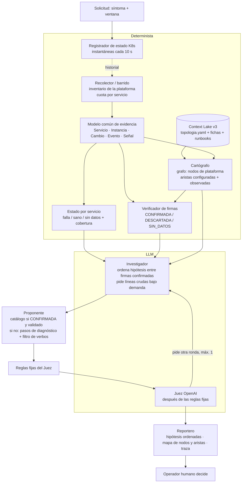

# Tider: asesor de incidentes para microservicios en contenedores (piloto Online Boutique)

*   **Author:** Max Houston Ramirez Martel
*   **Status:** Proposed
*   **Date:** 2026-11-09
*   **Alcance:** etapas 1 y 2 del RFC. Abarca la evaluación válida y el producto completo del piloto. El replay de SIBI queda para la etapa siguiente.
*   **Fuentes:** RFC `tider/docs/designs/tider-asesor-incidentes.md`; decisiones 1–27 de `recomend/_auditoria_consolidada.md`; validación externa `recomend/validacion/VALIDACION_CODEX.md`.

--------------------------------------------------------------------------------

## Overview

Tider ayuda a una persona de operaciones a responder tres preguntas durante un incidente en una aplicación de microservicios: qué componente falló, qué servicios solo sufrieron el efecto y qué conviene revisar o reparar. **Tider no ejecuta nada**: entrega un diagnóstico citado y la persona decide.

Este diseño cubre el piloto sobre **Online Boutique en GKE**. Las fallas se inyectan con ChaosForge, el laboratorio del equipo, que además registra cuál fue la falla real. El diseño deja preparada la extensión a otras plataformas (AWS ECS) mediante un modelo común de evidencia, pero no la construye.

Hoy existe un motor agéntico que investiga con herramientas de solo lectura y devuelve **un** componente con citas. Este diseño lo convierte en un asesor que:

*   recoge evidencia de forma determinista y completa antes de razonar;
*   evalúa firmas de falla con reglas verificables;
*   devuelve hipótesis ordenadas, separando la causa de las víctimas;
*   valida su propio diagnóstico con un juez de otra familia de modelos;
*   y se evalúa con un protocolo estadístico congelado de antemano.

## The Problem

**Para el operador.** Cuando falla un servicio, los errores aparecen sobre todo en quienes lo llaman. Por ejemplo, si cae `productcatalogservice`, los que más registran errores son `frontend`, `checkoutservice` y `recommendationservice`. Quien mira primero el servicio más ruidoso repara el equivocado y el incidente se alarga. Tider hoy no resuelve esto:

*   devuelve un solo componente, sin orden entre hipótesis ni rol causal (`console/agentic.py:95-109`);
*   el mapa marca un solo nodo y solo si el resultado es `hypothesis` (`static/js/catalog.js:146-164`);
*   la recomendación es texto libre del LLM, sin filtro que impida sugerir comandos de cambio (`agentic.py:35`);
*   el juez usa el mismo modelo que el investigador (`agentic.py:161,348`); en el caso C09 de E5 aprobó un hallazgo que la etiqueta marcaba como abstención.

**Para la evaluación.** Hoy no se puede afirmar que Tider diagnostica bien:

*   la respuesta correcta de ChaosForge (`/api/evidence`) se sirve en el mismo puerto que lee Tider (`chaosforge/admin/server.py:51-79`);
*   la búsqueda inicial de logs depende del catálogo del Context Lake, así que un error en el Lake sesga la evidencia (`investigation_tools.py:44-51`);
*   no existe un verificador de firmas: el LLM elige el mecanismo y solo se comprueba que las citas existan, no lo que dicen (`agentic.py:335-337`);
*   E5 ya no se reproduce con el código actual, y el benchmark de recuperación se midió con una versión anterior del buscador;
*   la rúbrica del curso objetó "expertos sin acuerdo medido" (C1–C4, 10/20).

**La solución propuesta**, en una línea: separar lo que se puede calcular (barrido de evidencia, firmas, estado de cada servicio, filtros) de lo que necesita juicio (ordenar hipótesis, explicar, validar), y medirlo con un protocolo que Tider no pueda contaminar.

## Goals

Cada objetivo tiene un criterio verificable. Los umbrales numéricos de éxito del piloto se fijan antes de la campaña (ver Open Questions).

1.  **Evidencia completa e independiente del Lake.** Un barrido determinista lee el inventario de servicios desde la plataforma (Deployments del namespace) y, para cada servicio, eventos, estado y una muestra acotada de logs de todas las severidades, con cuota propia por servicio. *Criterio:* en una corrida, los 12 servicios aparecen en la tabla del barrido con estado y cobertura, aunque el Lake esté vacío.
2.  **Estado por servicio con tres valores.** Cada servicio queda como falla confirmada, sano confirmado o sin datos, con un predicado explícito para "sano confirmado". *Criterio:* un servicio escalado a cero nunca aparece como sano; uno sin logs y sin eventos aparece como sin datos.
3.  **Firmas ejecutables.** Un verificador determinista evalúa las 4 firmas del catálogo v1 (servicio sin instancias, configuración incorrecta, dependencia lenta, saturación de CPU) con tabla de verdad, regla de precedencia y prioridad entre firmas. *Criterio:* en la validación con ChaosForge, la firma correcta da CONFIRMADA y las otras DESCARTADA o SIN_DATOS; se reporta la matriz de confusión.
4.  **Salida estructurada.** Tider devuelve hipótesis ordenadas. Cada una tiene componente, inicio, razón de un vocabulario cerrado, rol (causa, víctima o independiente), citas tipadas y la firma que la respalda, si existe. *Criterio:* esquema versionado validado por Pydantic; el componente actual se mantiene como alias para no romper la UI ni el historial.
5.  **Reparación con política explícita.** El Proponente muestra la acción de catálogo solo si la firma está CONFIRMADA y el runbook fue validado. En cualquier otro caso entrega pasos de diagnóstico marcados como "sugerencia no verificada", y un filtro rechaza verbos de cambio en ese texto. *Criterio:* prueba automática con recomendaciones que contienen `delete`, `scale`, `patch`, `rollout`, `apply` y `set`.
6.  **Juez independiente y medible.** El juez usa un modelo de OpenAI, configurable, más reglas fijas que se aplican antes del LLM. *Criterio:* tasa de falsa aprobación medida sobre un conjunto de diagnósticos falsos fabricados y sobre los errores naturales, comparando tres brazos: sin juez, juez del mismo proveedor y juez de OpenAI.
7.  **Context Lake v3 cargado como corresponde a cada tipo.** La topología se carga como grafo desde `topologia.yaml`; fichas y runbooks, como fragmentos completos; postmortems, por sección. Todos con metadatos y una versión congelada con hash. *Criterio:* la carga del Lake v3 produce 12 fichas y 6 runbooks como fragmentos únicos y el manifiesto lista el hash de cada documento.
8.  **Mapa con estado y rol.** La consola pinta cada servicio con su estado (3 valores) y su rol en la hipótesis principal, y muestra las discrepancias entre el Lake y la evidencia. *Criterio:* en un caso de cascada, la causa y las víctimas se distinguen visualmente.
9.  **Ground truth aislado.** La respuesta correcta de ChaosForge se sirve desde un proceso o puerto que Tider no puede leer. *Criterio:* prueba automática que verifica que ninguna herramienta de Tider alcanza la ruta de evidencia.
10. **Traza por corrida.** Cada análisis registra los modelos usados, el hash de los prompts, la versión del Lake y del catálogo, las consultas al Lake y las firmas evaluadas. *Criterio:* una corrida guardada contiene todo lo necesario para recalcular sus métricas sin llamar a ningún proveedor.
11. **Campaña con protocolo congelado.** La tabla de pares servicio×mecanismo, la separación entre historial y evaluación, los criterios de admisión de casos, la comparación principal, el tamaño de muestra y las exclusiones se fijan antes de correr. *Criterio:* el protocolo tiene un hash registrado antes de la primera corrida de evaluación; el informe reporta exactitud con Wilson, la comparación principal con McNemar exacto y κ entre Alberto y Jose sobre 30 casos.

## Non-Goals

*   **Ejecutar reparaciones.** Tider no cambia el clúster. La remediación queda para otra iteración (decisión 1).
*   **Replay de SIBI y adaptadores de AWS o Azure.** El modelo común se define, pero no se construye ningún adaptador fuera de GCP (decisiones 10, 20 y alcance de este diseño).
*   **Fallas sutiles fuera de `cartservice`.** `wrong_port`, `latency` y `cpu_limit` solo actúan sobre `cartservice` en ChaosForge. Extenderlos es trabajo de ChaosForge, no de este diseño (decisión 18).
*   **Fallas simultáneas.** ChaosForge permite un solo experimento activo.
*   **Puntaje de confianza calibrado.** Las hipótesis se ordenan y llevan cobertura; no llevan probabilidad (decisión 19).
*   **Validar "se cae al arrancar" y "sin memoria".** Quedan declaradas, sin inyector ni reparación verificada (decisión 21).
*   **Pasar las herramientas a MCP.** MCP sigue siendo solo un transporte posible dentro de un adaptador (decisión 10).
*   **Sistema multiagente con coordinador.** Es un solo motor con seis roles, de los cuales dos usan LLM (decisión 8).

## Open Questions

Todas las preguntas abiertas antes del plan técnico quedaron resueltas (ver abajo). Las nuevas que surjan se agregan aquí.

*   Ninguna por ahora.


### Preguntas resueltas

*   **Prioridad entre firmas (2026-11-09): todas como hipótesis paralelas.** No hay una regla fija. Cada firma CONFIRMADA entra como hipótesis candidata y el Investigador (LLM) las ordena con una justificación, que el Juez valida. El LLM solo puede ordenar firmas confirmadas o responder "ninguna / no visto" (decisión 21). Consecuencias que el plan técnico debe cubrir:
    *   la exactitud se puntúa sobre la primera hipótesis del orden, así que hacen falta repeticiones por caso para medir la variación entre corridas, sin contarlas como casos independientes;
    *   el Juez recibe una regla fija adicional: si hay varias firmas confirmadas, la justificación del orden debe citar evidencia temporal (qué empezó antes) o un Cambio previo;
    *   la traza guarda el conjunto completo de firmas confirmadas, para medir aparte la exactitud del verificador y la del orden.
*   **Entidad de una hipótesis (2026-11-09): servicio o enlace.** La entidad es un servicio del inventario o un enlace `origen→destino` del grafo de dependencias. La latencia introducida en el proxy queda como el enlace `cartservice→redis-cart`. Consecuencias:
    *   la rúbrica se reescribe: una etiqueta de enlace acepta como acierto exacto el enlace, y como acierto parcial (reportado aparte) cualquiera de sus dos extremos; una etiqueta de servicio solo acepta el servicio;
    *   las etiquetas de ChaosForge se traducen: `latency` → enlace `cartservice→redis-cart`; `scale_zero`, `wrong_port` y `cpu_limit` → servicio;
    *   el mapa pinta aristas, no solo nodos;
    *   un enlace solo puede nombrarse si existe en el grafo (configurado en el Lake u observado en errores que nombran el destino); si no existe, es una discrepancia y se reporta como hallazgo.
*   **Inventario del grafo (2026-11-09): plataforma más Lake.**
    *   **Nodos:** salen de la plataforma (Deployments y StatefulSets del namespace). El barrido cubre todos, tanto los de la tienda como los auxiliares, sin filtrar por el Lake.
    *   **Aristas:** tienen dos orígenes y cada una lo lleva marcado: `configurada` (de `topologia.yaml` en el Lake) u `observada` (variables `*_ADDR` del spec o errores que nombran un destino).
    *   **Discrepancias:** un nodo que solo está en el Lake o solo en la plataforma, o una arista observada que el Lake no tiene, se reporta como hallazgo.
    *   **Riesgo aceptado (inventario):** el Lake influye en qué enlaces existen. Para que no sesgue la evidencia, el barrido nunca usa las aristas para decidir qué leer; solo se usan después, para nombrar enlaces y separar causa de víctimas.

*   **Comparación confirmatoria (2026-11-09): juez de OpenAI frente a sin juez.** Es la única comparación prerregistrada; las demás (Tider frente a LLM directo, Lake con y sin postmortems, juez del mismo proveedor) se reportan como exploratorias.
    *   **Por qué la métrica no puede ser solo "falsas aprobaciones":** sin juez, todo diagnóstico se emite como respaldado, así que su tasa de falsa aprobación es 100 % por definición y la comparación sería trivial.
    *   **Métrica principal:** para cada diagnóstico candidato, la decisión del brazo es correcta si aprueba un diagnóstico verdadero o rechaza uno falso. Sin juez se aprueba todo. McNemar exacto pareado sobre los mismos candidatos.
    *   **Conjunto de candidatos:** diagnósticos naturales de la campaña más diagnósticos falsos fabricados sin conexión (causa y víctima intercambiadas, mecanismo cambiado, citas irrelevantes, solo documentos). La proporción de verdaderos y falsos se fija antes de correr, porque cambia el resultado.
    *   **Se reportan además, separadas:** tasa de falsa aprobación y tasa de falso rechazo del juez, cada una con intervalo de Wilson. Un juez que rechaza todo ganaría en falsos aprobados y perdería en falsos rechazos; las dos tasas juntas lo muestran.

*   **Umbrales de éxito (2026-11-09): sobre los límites del intervalo de Wilson al 95 %.** Unidad: caso independiente (una inyección); las repeticiones de un caso se resumen primero en un valor por caso.
    *   Exactitud de la primera hipótesis: **límite inferior ≥ 70 %**.
    *   Afirmaciones incorrectas (diagnóstico respaldado que no coincide con la etiqueta): **límite superior ≤ 15 %**.
    *   Latencia: p95 de la mediana por caso ≤ 120 s (descriptivo, sin intervalo).
    *   Acciones ejecutadas: 0.
    *   **Consecuencia para el tamaño de la campaña:** con 30 casos y una exactitud real de 85 %, el límite inferior sale ≈ 68 % y no alcanza el umbral; con 60 casos sale ≈ 74 %. El plan debe apuntar a **unos 60 casos independientes** como mínimo, o aceptar que con menos el umbral es probable que no se cumpla aunque Tider funcione.

*   **"Sano confirmado" (2026-11-09): plataforma, errores y tráfico.** Un servicio queda sano confirmado solo si se cumplen las tres cosas en la ventana:
    1.  réplicas listas = deseadas > 0, endpoints listos > 0 y ningún evento de terminación o escalado;
    2.  cero errores propios y ningún llamador con errores que lo nombren;
    3.  evidencia de tráfico: al menos K líneas de actividad normal propias o de sus llamadores (K se calibra con corridas sin falla; valor inicial K = 3).
    Si falta el tráfico, el servicio queda en **sin datos**, nunca en sano. Se espera que `emailservice`, `paymentservice` y `shippingservice` queden a menudo en sin datos cuando no hay compras en la ventana; el informe lo dice explícitamente.

## Critical User Journeys (CUJs)

### CUJ 1: Caída de una dependencia con muchas víctimas

*   **Given**: Online Boutique sana; ChaosForge escala `productcatalogservice` a cero durante 120 s; el loadgenerator genera tráfico.
*   **When**: El operador abre la consola y pide investigar "la tienda devuelve errores" en la ventana del incidente.
*   **Then**: Tider muestra `productcatalogservice` como causa, con firma "servicio sin instancias" CONFIRMADA y citas del evento de escalado y de los endpoints vacíos. Marca `frontend`, `checkoutservice` y `recommendationservice` como víctimas, con citas de sus errores que nombran al catálogo. Sugiere la acción de catálogo (restaurar réplicas) solo si el runbook RB-01 ya fue validado; si no, la presenta como sugerencia no verificada.

### CUJ 2: Configuración incorrecta que parece una caída de la dependencia

*   **Given**: ChaosForge cambia `REDIS_ADDR` de `cartservice` al puerto 6380 (`wrong_port`); `redis-cart` sigue sano.
*   **When**: El operador investiga "no se puede ver el carrito".
*   **Then**: Tider marca `cartservice` como causa con razón "configuración incorrecta", porque el cambio de configuración precede al primer error. Marca `redis-cart` como sano confirmado, aunque los errores lo nombran, y `frontend` como víctima.

### CUJ 3: Sin tráfico no hay diagnóstico inventado

*   **Given**: ChaosForge escala `loadgenerator` a cero; ningún servicio de la tienda falla.
*   **When**: El operador investiga "bajó la actividad".
*   **Then**: Tider no atribuye una falla a ningún servicio de la tienda. Las firmas que dependen de tráfico quedan en SIN_DATOS y el informe dice que se detuvo la generación de tráfico.

### CUJ 4: El evaluador mide sin que Tider vea la respuesta

*   **Given**: Protocolo congelado con su hash; ground truth servido en un proceso aparte; Lake v3 congelado.
*   **When**: El evaluador corre la campaña y luego el script de puntuación.
*   **Then**: Obtiene exactitud con intervalo de Wilson, la comparación principal con McNemar exacto, la tasa de falsa aprobación del juez y κ entre los dos evaluadores, todo recalculable desde las trazas sin llamar a ningún proveedor.

## Technical Plan (Architecture)

### Principio

Lo que se puede calcular lo hace código determinista: inventario, barrido, estado de cada servicio, firmas, filtros y puntuación. El LLM interviene en dos puntos que requieren juicio: el **Investigador**, que ordena hipótesis y explica, y el **Juez**, que valida. Cada paso deja traza para que la evaluación se pueda recalcular sin llamar a ningún proveedor.

### Flujo de una investigación



### 1. Evidencia histórica: registrador de estado y modelo común

**Problema que resuelve.** Hoy el estado de Kubernetes que lee Tider es el actual (`investigation_tools.py:237-274`, marcado `current_only_not_incident_history`). En la campaña, ChaosForge restaura el servicio a los 120 s, así que cuando Tider investiga el estado ya no es el del incidente. Los eventos sí son históricos porque vienen de Cloud Logging, pero los endpoints, las réplicas listas y el spec no.

**Componente nuevo: registrador de estado (`tider-recorder`).** Un proceso de solo lectura que cada 10 s guarda una instantánea del namespace: Deployments y StatefulSets (réplicas deseadas y listas, generación, hash del spec, variables `*_ADDR`, recursos), EndpointSlices (direcciones listas) y Pods (fase, `lastState.terminated` con motivo y código de salida). Guarda en SQLite con retención de 48 h. Usa el kubeconfig de solo lectura que ya existe para `service_state` (`AGENT_READER_KUBECONFIG`). En la campaña corre durante todas las corridas; en uso real, de forma continua. Si no corre, los campos históricos quedan vacíos y las firmas que los necesitan dan SIN_DATOS.

**Modelo común (`console/evidence/model.py`).** Las cinco piezas de `recomend/modelo_comun.md` como modelos Pydantic. Toda observación lleva `fuente` (`cloud_logging`, `k8s_events`, `recorder`, `observer`, `monitoring`), `texto_original` y un id citable `S##`. Un adaptador (`console/evidence/gke.py`) traduce Cloud Logging, el log de eventos, el registrador, el observador de ChaosForge y Cloud Monitoring a ese modelo. Los adaptadores de ECS/CloudWatch quedan fuera de este diseño, pero el modelo no tiene nada propio de GCP.

**Límites conocidos, declarados en el informe:**
*   `latencia_dependencia_p95` solo existe para el enlace `cartservice→redis-cart`, a través del observador de ChaosForge (PING a Redis). Online Boutique no expone métricas de latencia por dependencia y no hay trazas. Para cualquier otro enlace, la firma "dependencia lenta" da SIN_DATOS.
*   `cpu_throttling` sale de Managed Prometheus, como hoy hace el observador de ChaosForge, y solo si la identidad de lectura tiene permiso de Monitoring.

### 2. Recolector (barrido)

Módulo `console/sweep.py`. Corre antes de cualquier llamada al LLM, con presupuesto propio de registros y de tiempo, separado del presupuesto del Investigador.

1.  **Inventario:** todos los Deployments y StatefulSets del namespace según el registrador (o el estado actual si no hay registrador). No se filtra por el Lake.
2.  **Eventos:** todo el namespace en la ventana, sin filtro por nombre de servicio (hoy `kubernetes_events.py:19,28` filtra por el catálogo).
3.  **Logs:** por cada servicio, una muestra con cuota fija (por ejemplo, 40 registros de todas las severidades), tomada en orden temporal, más una ventana previa a t0 como línea base de ruido. Si un servicio llena su cuota, queda marcado `truncado`.
4.  **Métricas:** CPU y latencia donde haya fuente.
5.  **Salida:** el modelo común completo y una tabla de 1 fila por servicio con conteo por severidad, plantillas de error deduplicadas, primera y última marca, eventos, réplicas, endpoints y cobertura.

**Estado por servicio.** Regla determinista con el predicado de "sano confirmado" acordado (plataforma + cero errores + tráfico ≥ K). Falla confirmada = alguna firma CONFIRMADA sobre el servicio, o errores propios con anomalía respecto de la línea base. El resto queda en sin datos.

### 3. Cartógrafo

Módulo `console/topology.py`. Construye el grafo:
*   **Nodos:** el inventario de la plataforma, cada uno marcado `tienda` o `auxiliar` (auxiliar si no figura en `topologia.yaml` y su nombre coincide con un patrón de laboratorio u observabilidad).
*   **Aristas configuradas:** de `topologia.yaml`, versión congelada del Lake.
*   **Aristas observadas:** de las variables `*_ADDR` del spec (registrador) y de errores que nombran un destino `host:puerto`.
*   **Discrepancias:** nodo solo en el Lake, nodo solo en la plataforma, arista observada sin arista configurada, o variable que apunta a un componente auxiliar (por ejemplo, `REDIS_ADDR=chaosforge-proxy:6379`).

Reemplaza a `providers/catalog.py` y a `related_services()` como fuente de relaciones. La consola sigue aceptando el catálogo confirmado manual para compatibilidad, pero el diagnóstico usa este grafo.

### 4. Verificador de firmas

Módulo `console/signatures.py` y catálogo en datos `console/resources/catalog_v1.yaml`. Cada firma se describe como datos y no como código: id, modo de falla, entidad (`servicio` o `enlace`), predicados obligatorios, de descarte y corroborantes. Cada predicado tiene campo del modelo, operador, umbral y persistencia mínima. El verificador:

1.  evalúa cada firma sobre cada entidad candidata (servicios con anomalía y enlaces del grafo cuyos extremos tienen anomalía);
2.  aplica la precedencia SIN_DATOS → DESCARTADA → CONFIRMADA, y la marca `conflicto` cuando confirma y descarta a la vez;
3.  devuelve, por cada par (entidad, firma), el veredicto, `t_inicio` (primer punto anómalo) y los ids de la evidencia que lo sostiene.

Los umbrales iniciales salen de los runbooks y de ChaosForge (marcados [INF]) y se calibran con la línea base de corridas sin falla (media ± 3σ, OpenRCA A.5). El verificador es también el **baseline sin LLM**: reemplaza a `baseline.py` en el modo por reglas.

### 5. Contrato de diagnóstico (salida)

`console/models.py` agrega `schema_version = 2` y estos tipos:

```text
Entidad      = { tipo: "servicio", servicio: str }
             | { tipo: "enlace", origen: str, destino: str }

Cita         = { id: "S##" | "D##", clase: "evidencia" | "antecedente" }
               # S = señal observada; D = fragmento del Context Lake

Hipotesis    = { orden: int,
                 entidad: Entidad,
                 t_inicio: datetime | null,
                 razon: "servicio-sin-instancias" | "configuracion-incorrecta" | "dependencia-lenta"
                      | "saturacion-cpu" | "se-cae-al-arrancar" | "sin-memoria" | "desconocida",
                 firma_id: str | null,             # null solo si razon = "desconocida"
                 rol: "causa" | "victima" | "independiente",
                 citas: [Cita],                    # al menos una de clase "evidencia"
                 justificacion_orden: str }        # obligatoria si hay >1 firma confirmada

Nodo         = { servicio, estado: "falla" | "sano" | "sin_datos", rol_en_principal, cobertura, truncado }
Arista       = { origen, destino, origen_dato: "configurada" | "observada" | "ambas", estado }
Recomendacion= { tipo: "catalogo" | "diagnostico_no_verificado", runbook_id | null, texto, validada: bool }

Analysis v2  = { ...campos actuales,
                 hipotesis: [Hipotesis], nodos: [Nodo], aristas: [Arista],
                 discrepancias: [str], recomendacion: Recomendacion,
                 component: str }   # alias = servicio de la hipótesis 1 (o el origen si es un enlace)
```

El campo `component` se mantiene para no romper la UI ni el historial guardado en SQLite. Un análisis v1 sigue siendo legible.

### 6. Investigador

Se modifica `console/agentic.py`. Cambian tres cosas:
*   **Entrada:** recibe la tabla de servicios, el grafo y la lista de firmas confirmadas, en lugar de empezar con una búsqueda global de errores. Sus herramientas siguen disponibles para pedir líneas crudas, eventos o el Lake.
*   **Salida:** una lista `hipotesis` con el contrato anterior. Solo puede usar firmas CONFIRMADAS; si no hay ninguna, responde con razón `desconocida`.
*   **Prompt:** se reescribe el bloque de formato (`agentic.py:32-38`) y se elimina la lista fija de mecanismos de ChaosForge (`agentic.py:36,108`), que se reemplaza por el vocabulario de razones.

### 7. Proponente

Módulo `console/proposer.py`, determinista:
*   si la hipótesis 1 tiene firma CONFIRMADA y su runbook figura como validado en `catalog_v1.yaml` (`validado: true` solo después de la validación con ChaosForge), devuelve la acción del runbook como texto para la persona;
*   si no, una **llamada LLM dedicada** (mismo proveedor y modelo que el Investigador; decidido al cerrar, 2026-11-09) redacta pasos de diagnóstico de solo lectura a partir de la hipótesis 1, su evidencia citada y la sección "Pasos de verificación" del runbook más cercano. El texto pasa por el **filtro de verbos**.
*   Con esto Tider tiene **2 roles LLM y 3 puntos de llamada**: Investigador, respaldo del Proponente y Juez.
*   El filtro de verbos rechaza `delete`, `scale`, `patch`, `rollout`, `apply`, `set`, `edit`, `replace`, `restart`, `drain` y `cordon`, y también `aws ecs update-service`. Si el texto no pasa el filtro, se reemplaza por los pasos de verificación de solo lectura del runbook correspondiente.

### 8. Juez

**Reglas fijas** (en `agentic.py`, antes del LLM). Un incumplimiento rechaza el diagnóstico con motivo:
1.  cada cita existe y es del tipo correcto; la causa tiene al menos una cita de evidencia sobre su propia entidad dentro de la ventana;
2.  la entidad causa tiene estado `falla` (no `sin_datos`);
3.  si hay más de una firma confirmada, `justificacion_orden` cita un `t_inicio` o un Cambio previo;
4.  la recomendación pasó el filtro de verbos;
5.  si la cobertura del barrido es baja (servicios truncados o conectores fallidos), el análisis se marca `incompleto`.

**Juez LLM.** Nuevo `OpenAILLM` en `tider/llm.py` con la misma interfaz `complete_json(agent, system, user, timeout)`. La configuración agrega `judge_provider` (`anthropic` | `openai`) y `judge_model`. El juez recibe la solicitud, el diagnóstico, las citas resueltas a su texto y la tabla de servicios. Si pide otra ronda, el Investigador tiene una más como máximo (hoy son hasta 12 pasos sin límite de rondas).

**Datos.** En el piloto solo hay telemetría del laboratorio. En el replay de SIBI (fuera de alcance), el juez de OpenAI solo recibiría datos ya anonimizados (cláusula 5).

### 9. Reportero y mapa

`static/js/catalog-map.js` y `catalog.js` pintan cada nodo según su estado (3 colores) y un borde según su rol en la hipótesis principal, y cada arista según su origen y su estado. El enlace causa, si lo hay, se resalta. Las discrepancias se listan debajo del mapa. El flujo de etapas (`flow.js`) muestra el barrido, el verificador, el Investigador, el Proponente, el Juez y el Reportero.

### 10. Context Lake v3

Se modifica `console/context_lake.py`:
*   **Tipos por front matter:** se lee `tipo_doc` y se conservan los metadatos (servicio, mecanismo, fecha, revisión, fuente). Hoy se descartan (`context_lake.py:86-98`) y el tipo sale de la extensión (`:179`).
*   **Chunking por tipo:** `ficha` y `runbook`, un solo fragmento; `postmortem`, uno por sección `##` con el id del padre; `topologia.yaml`, no entra al índice vectorial y se carga como grafo en el Cartógrafo.
*   **Dos vías de acceso (decidido al cerrar, 2026-11-09):**
    *   **por clave**, como vía principal: `get(tipo_doc, servicio | modo_falla)` devuelve la ficha del servicio o el runbook del modo de falla sin ranking. La usan el verificador, el Proponente y el Cartógrafo;
    *   **por búsqueda híbrida** con filtros por `servicio` y `tipo_doc` (filtro `where` de Chroma): la usa el Investigador para buscar por síntoma (herramienta `context_search`) y es la única vía para los postmortems.
*   **Límites:** los documentos pasan de 20 a 60 y los fragmentos de 300 a 600.
*   **Versión congelada:** un manifiesto con el hash de cada documento, el modelo de embeddings y la revisión; la traza de cada corrida guarda el hash del manifiesto.

### 11. Aislamiento del ground truth

En ChaosForge (`admin/server.py`), las rutas `/api/evidence` y `/api/state` pasan a un segundo puerto de administración que no se expone por el túnel que usa Tider. El puerto del túnel (8092) sirve solo `/api/observations`. Una prueba en ChaosForge verifica que las rutas de evidencia respondan 404 en el puerto del observador. Una prueba en Tider verifica que ninguna URL configurable apunte al puerto de administración. El runner de la campaña lee el ground truth desde el puerto de administración, en un proceso aparte de Tider.

### 12. Traza y evaluación

**Traza por corrida.** Cada análisis exporta un JSON con: modelos y proveedores del Investigador y del Juez, hash de los prompts, hash del manifiesto del Lake y del catálogo de firmas, la tabla del barrido, todas las firmas evaluadas con su veredicto, las consultas al Lake con los ids recuperados, las hipótesis y las decisiones del juez. Se guarda en `out/runs/` junto a las respuestas del modelo para el replay.

**Campaña (`eval/pilot/`):**
*   `protocol.yaml`: tabla de pares servicio×mecanismo, separación historial / evaluación / control, criterio de admisión (síntoma en logs o eventos distinto del evento de la inyección), n objetivo (60 casos independientes), comparación confirmatoria, umbrales y exclusiones. Su hash se registra antes de la primera corrida.
*   `runner.py`: orquesta ChaosForge (inyectar, esperar, restaurar), el registrador y Tider; congela la ventana de evidencia de cada caso para el replay.
*   `judge_set.py`: genera los diagnósticos falsos fabricados a partir de los casos reales (causa y víctima intercambiadas, razón cambiada, citas irrelevantes, solo antecedentes).
*   `score.py`: exactitud de la primera hipótesis con Wilson, afirmaciones incorrectas, McNemar exacto de la comparación confirmatoria, tasas del juez y κ de Cohen. Reutiliza `proportion()` y `paired()` de `eval/quality/score.py`.
*   `kappa_form.csv`: los 30 casos para Alberto y Jose, sin indicar la variante que los produjo.

### Riesgos técnicos del plan

*   **Costo de laboratorio:** 60 casos de evaluación, más 5 de historial y los controles, a unos 12 minutos cada uno, suman cerca de 14 horas de GKE en serie.
*   **Permisos:** el registrador y las métricas de CPU necesitan una identidad de solo lectura con acceso a la API de Kubernetes y a Monitoring. Hay que verificarlo antes de la campaña.
*   **Dependencia lenta sin fuente:** fuera de `cartservice→redis-cart` la firma queda en SIN_DATOS; está declarado.
*   **Variación del LLM en el orden:** se mide con repeticiones por caso, pero agrega costo de tokens.

## Alternatives Considered

Las alternativas vienen de la sección "Alternativas evaluadas" del RFC y de las decisiones tomadas durante este borrador.

### Alcance y autonomía

#### Alternativa A: conservar el grafo del núcleo como "fase 2: remediación"
*   **Pros:** aprovecha el atlas de 13 páginas y el ejecutor ya escrito.
*   **Cons:** está hecho para otra aplicación (OpenTelemetry Demo) y otra autonomía (ejecuta `restart`, `undo` y `scale`). Con dos sistemas, el informe se vuelve incoherente.
*   **Motivo del rechazo:** rechazada por el autor (decisión 6). Se archivó dentro del repositorio, fuera del producto.

#### Alternativa B: solo Kubernetes, con SIBI fuera de alcance
*   **Pros:** un único tipo de plataforma y un diseño más simple.
*   **Cons:** la aplicación real objetivo, SIBI, corre en AWS ECS Fargate, sin Kubernetes.
*   **Motivo del rechazo:** rechazada por el autor (decisión 20). Se define un modelo común de evidencia; el adaptador de ECS queda fuera de este diseño.

#### Alternativa C: MCP como capa de abstracción para varias nubes
*   **Pros:** reutiliza servidores MCP de cada proveedor.
*   **Cons:** cada MCP expone herramientas y lenguajes de consulta distintos. El LLM tendría que escribir consultas de cada nube y se perdería la validación de argumentos en Python.
*   **Motivo del rechazo:** rechazada por el autor (decisión 10). MCP queda solo como transporte posible dentro de un adaptador.

### Evidencia y conocimiento

#### Alternativa D: el Context Lake como fuente de verdad
*   **Pros:** documentación curada, sin el ruido de los logs.
*   **Cons:** el Lake no contiene lo que pasó en el incidente. Si además decide qué se consulta, sesga la evidencia.
*   **Motivo del rechazo:** rechazada por el autor (decisión 3). El Lake es un mapa previo; la evidencia manda.

#### Alternativa E: investigación sin barrido previo
*   **Pros:** el LLM decide qué mirar, sin un costo fijo inicial.
*   **Cons:** si el LLM no consulta un servicio, ese servicio queda sin estado y nadie lo nota.
*   **Motivo del rechazo:** rechazada por el autor (decisión 9). El barrido determinista con cuota por servicio va antes del LLM.

#### Alternativa F: usar solo el estado actual de Kubernetes, sin registrador
*   **Pros:** sin componente nuevo; `service_state` ya existe.
*   **Cons:** en la campaña, ChaosForge restaura el servicio a los 120 s, así que el estado actual ya no es el del incidente. Réplicas, endpoints y spec quedarían en SIN_DATOS.
*   **Motivo del rechazo:** rechazada por el autor al aprobar el Technical Plan. Se agrega el registrador de estado.

#### Alternativa G: inventario solo de la plataforma, o con una lista fija de la app
*   **Pros:** el grafo es totalmente independiente del Lake, o estable y simple.
*   **Cons:** con solo la plataforma no aparecen las aristas sin tráfico ni variable visible. Con una lista fija no se ven los componentes nuevos y hay que mantenerla por aplicación.
*   **Motivo del rechazo:** rechazada por el autor (borrador, 2026-11-09). Nodos de la plataforma y aristas configuradas más observadas, cada una con su origen.

#### Alternativa H: preguntas de Hit@k redactadas por el equipo
*   **Pros:** rápidas de escribir.
*   **Cons:** el equipo conoce las respuestas y las preguntas no se parecen a lo que el Investigador envía de verdad.
*   **Motivo del rechazo:** rechazada por el autor (decisión 16). Se usan las consultas reales registradas en la traza.

### Diagnóstico

#### Alternativa I: mapa con un solo culpable
*   **Pros:** respuesta simple de mostrar.
*   **Cons:** oculta las víctimas y la incertidumbre, que es justo lo que confunde al operador.
*   **Motivo del rechazo:** rechazada por el autor (decisión 2). Hipótesis ordenadas con rol causal.

#### Alternativa J: regla fija de prioridad entre firmas (la que empieza antes, o la que tiene un cambio previo)
*   **Pros:** determinista, sin variación entre corridas y fácil de puntuar.
*   **Cons:** con datos de resolución de 1 minuto los inicios empatan. Un despliegue ajeno en la ventana acapararía la causa.
*   **Motivo del rechazo:** rechazada por el autor (borrador, 2026-11-09). Todas las firmas confirmadas pasan como hipótesis y el Investigador las ordena con una justificación que el Juez valida.

#### Alternativa K: la entidad es siempre un servicio, o los auxiliares cuentan como componentes
*   **Pros:** siempre un servicio: coincide con la etiqueta de ChaosForge y no cambia la UI. Auxiliares como componentes: preciso en el laboratorio.
*   **Cons:** siempre un servicio: atribuye mal una falla que está a mitad de la ruta. Auxiliares como componentes: mete un artefacto del laboratorio en el producto y no se traslada a SIBI.
*   **Motivo del rechazo:** rechazada por el autor (borrador, 2026-11-09). La entidad es un servicio o un enlace.

#### Alternativa L: confianza expresada por el LLM
*   **Pros:** un número fácil de mostrar.
*   **Cons:** no se puede calibrar con decenas de casos, y el juez tiene prohibido calcularla.
*   **Motivo del rechazo:** rechazada en la revisión y aceptada por el autor (decisión 19). Orden y cobertura.

#### Alternativa M: "sano confirmado" solo con la plataforma, o con la plataforma y cero errores
*   **Pros:** menos servicios en "sin datos" y un mapa más lleno.
*   **Cons:** solo con la plataforma, marca sano un servicio arriba pero mal configurado. Con cero errores, marca sano un servicio que nadie llamó.
*   **Motivo del rechazo:** rechazada por el autor (borrador, 2026-11-09). Se exige además evidencia de tráfico.

### Reparación y control

#### Alternativa N: reparaciones solo por LLM
*   **Pros:** cubre cualquier caso.
*   **Cons:** texto libre sin control. Puede sugerir comandos de cambio con mucha seguridad y no hay contra qué evaluarlo.
*   **Motivo del rechazo:** rechazada por el autor (decisión 4). Catálogo primero; el LLM solo como respaldo de diagnóstico, con filtro de verbos.

#### Alternativa O: catálogo nombrado por el mecanismo del inyector
*   **Pros:** correspondencia directa con ChaosForge.
*   **Cons:** es una hoja de respuestas: el nombre de la entrada revela la etiqueta de evaluación.
*   **Motivo del rechazo:** rechazada en la revisión y aceptada por el autor (decisión 19). Modo de falla genérico; el mecanismo es solo una etiqueta de evaluación.

#### Alternativa P: juez del mismo modelo que el Investigador
*   **Pros:** sin un segundo proveedor ni otro adaptador.
*   **Cons:** comparte los sesgos del Investigador.
*   **Motivo del rechazo:** rechazada por el autor (decisiones 8 y 23). El juez usa OpenAI. El juez del mismo proveedor queda como brazo exploratorio.

### Evaluación

#### Alternativa Q: otra comparación confirmatoria (Tider frente a LLM directo, o Lake con y sin postmortems)
*   **Pros:** Tider frente a LLM directo es la que pide el pitch. Lake con y sin postmortems mide el aporte de la memoria.
*   **Cons:** las dos rozan el techo con `scale_zero` y tendrían pocos pares discordantes con el n alcanzable.
*   **Motivo del rechazo:** rechazada por el autor (borrador, 2026-11-09). La confirmatoria es juez de OpenAI frente a sin juez; las otras dos se reportan como exploratorias.

#### Alternativa R: umbrales de éxito sobre el valor observado, o sin umbral
*   **Pros:** el valor observado es la regla de E5 y es fácil de explicar. Sin umbral se evita fallar por n chico.
*   **Cons:** sobre el valor observado, el umbral se puede cumplir por azar. Sin umbral no hay criterio para seguir al replay de SIBI.
*   **Motivo del rechazo:** rechazada por el autor (borrador, 2026-11-09). Los umbrales se aplican sobre los límites del intervalo de Wilson.

#### Alternativa S: estratificar el reparto ya, con fallas sutiles no vistas
*   **Pros:** mediría diagnóstico fuera del caso trivial.
*   **Cons:** exige habilitar mecanismos en otros servicios de ChaosForge y deja celdas pequeñas.
*   **Motivo del rechazo:** rechazada por el autor (decisión 18). La afirmación queda acotada y la extensión es el siguiente paso.

--------------------------------------------------------------------------------

## Non-Functional Requirements

*   **Seguridad y privacidad.**
    *   Todo acceso al clúster es de solo lectura: el registrador y el barrido usan el kubeconfig de lectura, y Tider no tiene ninguna herramienta de escritura.
    *   El ground truth de ChaosForge queda en un puerto que no sale por el túnel que usa Tider.
    *   El enmascarado actual (`providers/redaction.py`) se aplica a todo texto que llegue a un LLM, incluido el juez de OpenAI.
    *   La clave de OpenAI se lee de variables de entorno y nunca se escribe en la traza.
*   **Costo y latencia.**
    *   Presupuesto del barrido: 12 servicios × 40 registros + eventos del namespace. Va separado del presupuesto del Investigador (2.000 registros, 90 s).
    *   El juez agrega una llamada a OpenAI por ronda (máximo 2 rondas). El respaldo del Proponente agrega como máximo 2 llamadas, solo cuando no hay acción de catálogo.
    *   Meta de latencia: p95 de la mediana por caso ≤ 120 s.
*   **Compatibilidad y vuelta atrás.**
    *   `Analysis` v2 conserva `component`, así que los análisis v1 guardados en SQLite siguen siendo legibles.
    *   El modo nuevo se activa con `TIDER_PIPELINE=v2` (valor por defecto `v1` hasta terminar la validación de firmas). Volver atrás es cambiar la variable.

--------------------------------------------------------------------------------

## Detailed Implementation Plan

Rutas relativas a `project/code/tider/` salvo que se indique otro repositorio. Rama de trabajo: partir de `archivo-grafo-antiguo` una vez confirmada. El orden de las fases respeta las dependencias: cada fase deja la suite en verde.

### Fase 1: modelo de evidencia, registrador y barrido

#### 1. `src/tider/console/evidence/__init__.py` (Create)
*   **Tipo / alcance:** paquete Python.
*   **Cambios:** exporta los tipos del modelo común y la interfaz `EvidenceAdapter`.

#### 2. `src/tider/console/evidence/model.py` (Create)
*   **Tipo / alcance:** modelos Pydantic.
*   **Cambios:**
    *   `Servicio`, `Instancia`, `Cambio`, `Evento` y `Senal` según `recomend/modelo_comun.md`, con `endpoints_listos`, `latencia_dependencia_p95` + `destino` y `terminaciones_en_ventana`.
    *   Cada observación lleva `id` (`S##`), `fuente`, `texto_original` y `tiempo`.
    *   `CoberturaServicio` lleva `truncado`, `fuentes_fallidas` y `registros_leidos`.
*   **Por qué:** es el contrato único sobre el que se escriben las firmas (decisión 22).

#### 3. `src/tider/console/evidence/gke.py` (Create)
*   **Tipo / alcance:** adaptador.
*   **Cambios:** `GKEAdapter.collect(ventana, inventario, cuotas) -> Evidencia`. Combina estas fuentes:
    *   logs con `gcp_signals`, reutilizado con todas las severidades y una cuota por servicio;
    *   eventos con `gcp_events`, sin filtro de nombres;
    *   instantáneas del registrador;
    *   observador de ChaosForge, si está configurado;
    *   Cloud Monitoring para CPU, si está habilitado.
*   **Por qué:** concentra todo lo propio de GCP en un solo lugar, para que un adaptador de ECS futuro implemente la misma interfaz.

#### 4. `src/tider/console/providers/kubernetes_events.py` (Modify)
*   **Cambios:** `event_filter` acepta `services=None` para leer todo el namespace sin la regex de nombres, y `event_from_entry` asigna el servicio por prefijo cuando no hay lista. Se mantiene la firma actual para no romper a quienes la llaman.
*   **Por qué:** con el filtro por catálogo, el barrido quedaba atado al Lake.

#### 5. `src/tider/console/recorder.py` (Create)
*   **Tipo / alcance:** proceso de solo lectura y punto de entrada `tider-recorder`.
*   **Cambios:**
    *   cada 10 s guarda en SQLite (`RECORDER_DB_PATH`) una instantánea de Deployments, StatefulSets, EndpointSlices y Pods del namespace, usando `kubectl get -o json` con el kubeconfig de lectura (mismo patrón que `investigation_tools.service_state`);
    *   retención de 48 h;
    *   API interna `snapshots(desde, hasta) -> list` y `spec_at(servicio, t)`.
*   **Por qué:** es la única fuente histórica de réplicas, endpoints y spec (Technical Plan §1).

#### 6. `deploy/reader-rbac.yaml` (Create)
*   **Tipo / alcance:** manifiesto Kubernetes.
*   **Cambios:** Role y RoleBinding de solo lectura en `boutique` (`get` y `list` sobre `deployments`, `statefulsets`, `replicasets`, `pods`, `endpointslices` y `events`) para la identidad del lector.
*   **Por qué:** el registrador y el barrido necesitan esos permisos; el RBAC anterior se archivó con el ejecutor.

#### 7. `src/tider/console/sweep.py` (Create)
*   **Tipo / alcance:** módulo determinista (rol Recolector).
*   **Cambios:**
    *   `sweep(solicitud, settings) -> Barrido` toma el inventario del registrador (o del estado actual si no hay registrador), llama al adaptador y calcula la tabla por servicio: conteo por severidad, plantillas de error deduplicadas, primera y última marca, eventos, réplicas, endpoints y cobertura;
    *   la línea base usa una ventana previa a t0 de la misma duración;
    *   `estado_servicio()` aplica el predicado de sano acordado (con K configurable, valor inicial 3).
*   **Por qué:** decisión 9 y objetivos 1 y 2.

#### 8. `src/tider/console/settings.py` (Modify)
*   **Cambios:** agrega
    *   `pipeline` (`v1` | `v2`);
    *   `sweep_quota_per_service` (40);
    *   `sweep_timeout_seconds` (30);
    *   `healthy_traffic_min_lines` (3);
    *   `recorder_db_path`;
    *   `judge_provider` (`anthropic` | `openai`) y `judge_model`;
    *   `openai_api_key` (desde el entorno);
    *   `lake_max_documents` (60) y `lake_max_chunks` (600).

#### 9. `tests/console/test_evidence_model.py`, `test_recorder.py`, `test_sweep.py` (Create)
*   **Cobertura:**
    *   el modelo rechaza observaciones sin fuente;
    *   el registrador guarda y lee instantáneas con un kubectl simulado;
    *   el barrido cubre 12 servicios con el Lake vacío;
    *   un servicio con 0 réplicas nunca sale sano;
    *   un servicio sin tráfico sale sin datos;
    *   la cuota marca `truncado`.

### Fase 2: grafo y verificador de firmas

#### 10. `src/tider/console/topology.py` (Create)
*   **Tipo / alcance:** módulo determinista (rol Cartógrafo).
*   **Cambios:**
    *   `build_graph(inventario, lake_topology, spec_snapshots, errores) -> Grafo` con nodos marcados `tienda` o `auxiliar` y aristas con `origen_dato`;
    *   `discrepancias()` devuelve una lista de hallazgos en texto.
*   **Por qué:** decisión sobre el inventario del grafo; reemplaza a `providers/catalog.related_services()`.

#### 11. `src/tider/console/providers/catalog.py` (Modify)
*   **Cambios:** `EDGES` y `related_services()` quedan solo para el modo v1. Se marcan como obsoletos en el docstring. El modo v2 usa `topology.py`.

#### 12. `src/tider/console/resources/catalog_v1.yaml` (Create)
*   **Tipo / alcance:** datos.
*   **Cambios:**
    *   6 firmas, con id, modo de falla, entidad, predicados obligatorios, de descarte y corroborantes (campo, operador, umbral, persistencia), `runbook_id` y `validado: false`;
    *   las 4 firmas a validar pasan a `validado: true` solo después de la Fase 6;
    *   umbrales iniciales tomados de los runbooks RB-01 a RB-06 y marcados `[INF]`.

#### 13. `src/tider/console/signatures.py` (Create)
*   **Tipo / alcance:** módulo determinista.
*   **Cambios:**
    *   `evaluate(catalogo, evidencia, grafo) -> list[VeredictoFirma]` con la precedencia SIN_DATOS → DESCARTADA → CONFIRMADA y la marca `conflicto`;
    *   cada veredicto lleva entidad, `firma_id`, `t_inicio`, ids de evidencia y predicados cumplidos o faltantes;
    *   `baseline(veredictos) -> Analysis` reemplaza a `baseline.diagnose` en el modo por reglas v2.

#### 14. `tests/console/test_topology.py`, `test_signatures.py` (Create)
*   **Cobertura:**
    *   aristas configuradas y observadas, y discrepancia con `REDIS_ADDR=chaosforge-proxy:6379`;
    *   tabla de verdad de cada firma con casos positivo, negativo cercano, datos faltantes y contradictorio;
    *   ninguna firma CONFIRMADA cuando falta una fuente obligatoria.
*   Los fixtures se construyen a mano con el modelo común.

### Fase 3: contrato v2, Investigador, Proponente y Juez

#### 15. `src/tider/console/models.py` (Modify)
*   **Cambios:** agrega `Entidad`, `Cita`, `Hipotesis`, `Nodo`, `Arista` y `Recomendacion` según el Technical Plan §5. `Analysis` suma `schema_version`, `hipotesis`, `nodos`, `aristas`, `discrepancias`, `recomendacion_estructurada` y `incompleto`. `component` se calcula a partir de la hipótesis 1.
*   **Por qué:** objetivo 4. Mantener `component` evita romper la UI y el historial.

#### 16. `src/tider/llm.py` (Modify)
*   **Cambios:** agrega `OpenAILLM` con `complete_json(agent, system, user, timeout)` y `last_response_metadata` (tokens y modelo). Si falta el paquete `openai` o la clave, lanza un error claro.
*   **Por qué:** decisión 23.

#### 17. `pyproject.toml` (Modify)
*   **Cambios:**
    *   extra opcional `judge-openai = ["openai>=1,<3"]`;
    *   entry point `tider-recorder`;
    *   `console/resources/*.yaml` en package-data.

#### 18. `src/tider/console/agentic.py` (Modify)
*   **Cambios:**
    *   en modo v2, `analyze_live` llama primero a `sweep`, `topology` y `signatures`, y entrega al Investigador la tabla, el grafo y las firmas confirmadas; la búsqueda global inicial (`:395-398`) y el nodo `initial_events` (`:377-388`) se usan solo en v1;
    *   el prompt `SYSTEM` cambia el bloque de formato por la lista `hipotesis` y elimina la lista de mecanismos de ChaosForge;
    *   `Finding` se reemplaza por `Hipotesis` en v2;
    *   en `review`, las reglas fijas del Juez del Technical Plan §8 se aplican antes del LLM;
    *   el Juez usa `judge_provider` y `judge_model`;
    *   se permite como máximo una ronda adicional pedida por el Juez;
    *   la salida incluye nodos, aristas, discrepancias y la recomendación del Proponente.

#### 19. `src/tider/console/proposer.py` (Create)
*   **Tipo / alcance:** módulo determinista (rol Proponente).
*   **Cambios:**
    *   `propose(hipotesis, veredictos, catalogo, runbooks, llm) -> Recomendacion`;
    *   sin acción de catálogo, llama al LLM con un prompt propio (`PROPOSER_SYSTEM`: solo pasos de lectura, citar ids, nunca comandos de cambio) y pasa la salida por el filtro; si el filtro la rechaza dos veces, usa los pasos de verificación del runbook sin LLM;
    *   `verb_filter(texto) -> (ok, verbos_encontrados)` con la lista del Technical Plan §7, que aplica como palabras completas, sin distinguir mayúsculas y también dentro de bloques de código.

#### 20. `src/tider/console/investigation_tools.py` (Modify)
*   **Cambios:**
    *   el inventario de nombres válidos sale del grafo (plataforma) en v2 y no del catálogo confirmado (`:44-51`);
    *   se agrega la herramienta `sweep_lines(servicio, plantilla)` para pedir líneas crudas de una plantilla del barrido.

#### 21. `src/tider/console/analysis.py`, `service.py` (Modify)
*   **Cambios:** en v2, `LabEngine.analyze` (modo sin LLM) usa `signatures.baseline`; `AnalysisService` elige v1 o v2 según `settings.pipeline`.

#### 22. `tests/console/test_contract_v2.py`, `test_proposer.py`, `test_judge_rules.py` (Create); `test_agentic.py` (Modify)
*   **Cobertura:**
    *   un análisis v2 se serializa y un análisis v1 guardado se sigue leyendo;
    *   el filtro rechaza cada verbo prohibido y acepta pasos de solo lectura (`kubectl get`, `describe`, `logs`);
    *   el Proponente devuelve una acción de catálogo solo con firma CONFIRMADA y `validado: true`; sin ella, llama al LLM de respaldo (simulado) y, si el texto falla el filtro dos veces, cae en los pasos del runbook;
    *   cada regla fija del Juez rechaza su caso;
    *   el Juez usa `OpenAILLM` cuando `judge_provider=openai` (con un LLM simulado).
*   En `test_agentic.py`, las pruebas que verifican la búsqueda inicial quedan limitadas a v1.

### Fase 4: Context Lake v3 y mapa

#### 23. `src/tider/console/context_lake.py` (Modify)
*   **Cambios:**
    *   `extract()` conserva el front matter;
    *   `add()` decide el chunking por `tipo_doc` (ficha y runbook, un fragmento; postmortem, por `##` con `padre`) y guarda los metadatos en Chroma;
    *   `search(query, k, where=None)` acepta filtros (vía de búsqueda, para el Investigador);
    *   `get(tipo_doc, clave)` lee un documento completo por servicio o modo de falla, sin ranking (vía por clave, para el verificador, el Proponente y el Cartógrafo);
    *   los límites vienen de la configuración;
    *   `manifest() -> {doc_id: sha256, modelo, revision}`.
*   **Por qué:** decisión 12 y objetivo 7.

#### 24. `src/tider/console/lake_loader.py` (Create)
*   **Cambios:** `load_v3(carpeta)` carga `topologia.yaml` para el Cartógrafo y las fichas y runbooks al índice, omite `PLANTILLA.md` y `PENDIENTES.md`, y devuelve el manifiesto congelado. Punto de entrada: `tider-lake-load <carpeta>`.

#### 25. `tests/console/test_context_lake.py` (Modify) y `test_lake_loader.py` (Create)
*   **Cobertura:** 12 fichas y 6 runbooks producen 18 fragmentos; un postmortem de prueba produce un fragmento por sección; los filtros funcionan; `get()` devuelve exactamente la ficha o el runbook pedido; el manifiesto cambia si cambia un documento.

#### 26. `src/tider/console/static/js/catalog-map.js`, `catalog.js`, `render.js`, `flow.js` y `static/css/app.css` (Modify)
*   **Cambios:**
    *   el mapa pinta los nodos por estado y les pone un borde según su rol;
    *   pinta las aristas según su origen y resalta el enlace causa;
    *   muestra la lista de discrepancias;
    *   el panel de resultado lista las hipótesis ordenadas con sus citas y muestra la recomendación con la etiqueta "verificada" o "no verificada";
    *   el flujo muestra las etapas del modo v2.
*   **Por qué:** objetivo 8. El código actual solo marca un nodo cuando el estado es `hypothesis` (`catalog.js:146-164`).

#### 27. `src/tider/console/explanation.py` (Modify)
*   **Cambios:** traduce las etapas del modo v2 (barrido, verificador, investigador, proponente, juez, reportero) a pasos legibles.

### Fase 5: aislamiento del ground truth (repositorio `chaosforge`)

#### 28. `chaosforge/admin/server.py` (Modify)
*   **Cambios:**
    *   el servidor escucha en dos puertos: `--port` (observador), que sirve solo `/api/observations` y `/healthz`, y `--admin-port`, que sirve el panel, `/api/state`, `/api/evidence` y los POST;
    *   en el puerto del observador, cualquier otra ruta responde 404.

#### 29. `chaosforge/admin/k8s/admin.yaml` (Modify)
*   **Cambios:** el contenedor expone los dos puertos y el Service publica ambos con nombres distintos (`observer`, `admin`).

#### 30. `chaosforge/scripts/abrir-panel.sh` (Modify)
*   **Cambios:** el túnel del panel apunta al puerto `admin` en 127.0.0.1:8093, y un segundo túnel lleva el puerto `observer` a 127.0.0.1:8092, que es el único que se configura en Tider (`AGENT_OBSERVER_URL`).

#### 31. `chaosforge/admin/tests/test_http.py` (Modify)
*   **Cobertura:** `/api/evidence/<id>` y `/api/state` responden 404 en el puerto del observador y 200 en el de administración.

#### 32. `tests/console/test_ground_truth_isolation.py` (Create, repositorio `tider`)
*   **Cobertura:** `observer_url()` rechaza cualquier ruta distinta de la raíz, y la herramienta `operation_evidence` solo construye URLs `/api/observations`.

### Fase 6: validación de firmas, campaña y puntuación

#### 33. `eval/pilot/protocol.yaml` (Create)
*   **Tipo / alcance:** protocolo prerregistrado.
*   **Cambios:**
    *   pares servicio×mecanismo con su conjunto (historial, evaluación o control);
    *   etiquetas esperadas (entidad servicio o enlace, y razón);
    *   criterio de admisión y n objetivo (60);
    *   comparación confirmatoria y métrica (Technical Plan §12);
    *   umbrales de Wilson, composición del conjunto de mutaciones, número de repeticiones por caso (3) y exclusiones.

#### 34. `eval/pilot/runner.py` (Create)
*   **Cambios:**
    *   orquesta cada caso: verifica las precondiciones, llama al puerto de administración de ChaosForge para inyectar, espera, ejecuta Tider con las repeticiones y lee el ground truth después;
    *   congela la ventana de evidencia para el replay;
    *   tiene un modo `--validate-signatures` que solo corre el verificador y produce la matriz de confusión entre firmas.

#### 35. `eval/pilot/judge_set.py` (Create)
*   **Cambios:** genera los diagnósticos falsos fabricados desde los casos reales con cuatro transformaciones, más los verdaderos, en la proporción del protocolo. La semilla queda fija.

#### 36. `eval/pilot/score.py` (Create)
*   **Cambios:** calcula
    *   la exactitud de la primera hipótesis (servicio o enlace exacto, con el extremo de un enlace como acierto parcial aparte), resumida por caso;
    *   las afirmaciones incorrectas;
    *   McNemar de la comparación confirmatoria;
    *   las tasas de falsa aprobación y falso rechazo del juez;
    *   κ de Cohen;
    *   el cumplimiento de umbrales.
*   Reutiliza `proportion()` y `paired()` de `eval/quality/score.py`.

#### 37. `eval/pilot/kappa_form.py` (Create)
*   **Cambios:** exporta los 30 casos para los evaluadores en CSV, sin indicar la variante, con las 3 preguntas acordadas, y luego importa las dos planillas.

#### 37b. `eval/pilot/retrieval_check.py` (Create)
*   **Tipo / alcance:** análisis exploratorio, no confirmatorio (decidido al cerrar, 2026-11-09).
*   **Cambios:**
    *   toma de las trazas de la campaña las consultas reales que el Investigador hizo a `context_search`;
    *   un documento es relevante si es la ficha del servicio o enlace etiquetado, o el runbook de su modo de falla;
    *   mide Hit@1, Hit@4 y MRR en cuatro variantes: búsqueda híbrida, solo léxica, y cada una con los nombres de servicio enmascarados (`<SVC>`) en la consulta;
    *   reporta con Wilson y compara la híbrida con la léxica con `paired()` de `eval/quality/score.py`.
*   **Por qué:** decisión 16. Justifica con datos la estrategia de chunking, que es uno de los 4 puntos del asesor, sin ajustar nada sobre los datos de evaluación. El resultado se usa en la siguiente iteración, no en esta.

#### 38. `tests/console/test_pilot_score.py` (Create)
*   **Cobertura:** la puntuación de enlaces y servicios, el resumen por caso antes del intervalo, McNemar con pares conocidos, κ con un ejemplo de manual y el enmascarado de nombres de `retrieval_check.py`.

#### 39. `Context Lake/V3-piloto-online-boutique/runbooks/RB-01` a `RB-04` (Modify, fuera del repositorio)
*   **Cambios:** después de la validación, `estado_validacion` y la nota de pendiente se actualizan con el resultado y la fecha. Si una firma no pasa, su runbook queda como "declarado, no validado".

### Fase 7: documentación

#### 40. `README.md`, `docs/agentic-investigation.md`, `docs/context-lake.md`, `docs/testing.md` y `docs/decisions.md` (Modify)
*   **Cambios:**
    *   describen el modo v2, el registrador, las variables nuevas y cómo correr la campaña;
    *   `decisions.md` suma una entrada D08 con las decisiones de este diseño;
    *   el conteo de pruebas se actualiza al final.

#### 41. `docs/designs/tider-pagina-asesor.md` y `docs/designs/tider-blueprint.drawio` (Modify)
*   **Cambios:** las etiquetas 🔧 pasan a ✅ solo cuando la pieza esté construida y probada.

### Verification Plan

*   **Build:** `make setup` y `uv sync --extra llm --extra judge-openai --extra dev --frozen` (después de regenerar `uv.lock`).
*   **Pruebas unitarias:** `uv run pytest -q`. La suite actual (142) más las nuevas, todas en verde, en Tider. En ChaosForge: `python3 -m unittest discover -s admin/tests -v`.
*   **Análisis estático:** `uv run ruff check src tests`, sin errores nuevos sobre la base actual (20).
*   **Regresión de evaluación:** `uv run python -m eval.quality --verify` sigue dando el mismo informe.
*   **Integración en el laboratorio:**
    1.  `tider-recorder` corriendo y `tider-lake-load` del Lake v3;
    2.  `python -m eval.pilot.runner --validate-signatures`: matriz de confusión de las 4 firmas, con al menos una corrida por mecanismo y una corrida sin falla;
    3.  las 5 corridas de historial y los postmortems;
    4.  protocolo congelado con su hash;
    5.  la campaña;
    6.  `python -m eval.pilot.score`, con las métricas y el cumplimiento de umbrales.
*   **Aceptación:** los CUJ 1 a 4 se reproducen en la consola con el modo v2.


--------------------------------------------------------------------------------

*Drafted with EGM*
