# Atlas de arquitectura de TiderOps

**[Abrir atlas editable en draw.io](TiderOps_Arquitectura.drawio)** · 13 páginas. [Galería de vistas previas](index.html).

La implementación se organiza alrededor de un motor LangGraph compartido.
La consola web recibe la solicitud; FastAPI la valida; AnalysisService obtiene
las señales y administra el historial; LabEngine prepara y ejecuta el grafo.
Investigador, juez y reportero trabajan dentro del mismo proceso Python.
La política calcula la propuesta y la interfaz explica los eventos registrados.

## Cómo se hizo la implementación

1. **Unificar el proyecto.** La consola se incorporó al paquete `src/tider`, con
   dependencias declaradas en `pyproject.toml` y resueltas en `uv.lock`. Sus archivos
   web, escenarios y contexto se incluyen en la distribución instalable.
2. **Separar responsabilidades.** HTTP está en `console/api.py`; el caso de uso en
   `service.py`; la evidencia en `providers/`; la adaptación al grafo en `analysis.py`.
   Los contratos `EvidenceSource` y `DiagnosticEngine` permiten sustituir conectores
   en pruebas sin cambiar el caso de uso.
3. **Conservar un solo flujo de agentes.** `graph.py` conecta las etapas; `agents/`
   contiene su trabajo; `workflow/nodes.py` implementa decisión, ejecución y
   verificación; `decision/` conserva la política y sus umbrales.
4. **Aislar el estado.** Cada aplicación posee su historial acotado y protegido por
   un bloqueo. Cada análisis recibe herramientas, contexto y proveedor de
   razonamiento propios. El historial desaparece al reiniciar el proceso.
5. **Explicar la ejecución.** Los agentes registran eventos en `audit` y
   `explanation.py` los transforma en pasos con resultado, motivo y referencias
   a las señales. La explicación procede del flujo ejecutado.

Los motivos y alternativas de estas decisiones están en
[Decisiones de diseño](../decisions.md). Los diagramas 11 y 12 ubican los módulos
y muestran la reorganización.

## Dos entradas y dos elecciones independientes

| Aspecto | Consola de laboratorio | Entrada operativa del motor |
|---|---|---|
| Inicio | `python -m tider.console` | `tider.api:app` |
| Entrada | Formulario y API de análisis | Webhook autenticado de Alertmanager |
| Evidencia | Señales mock o logs de GCP | Registro de herramientas operativas |
| Contexto | InMemoryStore por análisis | Memoria o PgVectorStore configurado |
| Ejecución | Grafo compilado en observación | Adaptadores sujetos a política, dry-run y configuración |
| Historial de consola | Hasta 50 análisis por defecto | No utiliza el historial de la consola |

Dentro de la consola, **fuente** y **razonamiento** son elecciones independientes:
`EVIDENCE_MODE=mock|gcp` elige de dónde salen las señales; `LLM_PROVIDER=none|anthropic`
elige cómo se producen las respuestas del investigador, juez y reportero.
El modo local calcula una hipótesis con reglas sobre las señales y alimenta
`ScriptedLLM`; luego ejecuta el grafo completo. Las reglas no reciben la etiqueta
del escenario. Anthropic utiliza el adaptador externo cuando se configura.

La consulta GCP implementada devuelve logs. El enmascarado filtra patrones de
credenciales y correo; no representa una clasificación exhaustiva de datos
personales. Las vistas de despliegue describen configuración y código, no una
comprobación del estado de los servicios cloud.

## Ejemplo: Redis no disponible

1. El operador selecciona `redis_down` y envía el formulario.
2. El proveedor mock genera cuatro señales con la ventana solicitada. El servicio
   les asigna `S01` a `S04`.
3. El baseline encuentra errores de conexión a Redis y propone `redis-cart` con
   confianza heurística de `0,7`. Es la regla definida en el código.
4. El investigador lee las herramientas de logs, métricas y trazas; el juez evalúa
   la hipótesis y aplica los controles deterministas de evidencia.
5. El baseline propone revisión humana. La política conserva la ruta `escalate` y
   `preview_node` registra la propuesta, con `executed=false`.
6. El reporte y los pasos quedan en `Analysis`; el servicio añade duración, fecha e
   identificador, y guarda una copia en el historial.

Con `missing_telemetry`, no llegan señales. El juez deja la confianza en cero y
solicita evidencia. El grafo permite una segunda ronda; después entrega
`insufficient_evidence`. Esta respuesta también es un análisis completado.

## Reglas que explican una decisión

| Acción | Confianza mínima | Condiciones adicionales |
|---|---:|---|
| `rollout-restart` | 0,75 | Deployment permitido y relacionado con la hipótesis |
| `rollout-undo` | 0,85 | Rollout de hasta 120 minutos y al menos dos revisiones |
| `scale` | 0,75 | Sin HPA; aumento de réplicas, con máximo de cinco |
| PR de manifiestos | 0,70 | Categoría de cambio permitida |
| PR de aplicación | 0,80 | Categoría de cambio permitida |

Además se exige respaldo del juez y namespace permitido. Para runbooks se excluyen
deployments protegidos y se aplican los límites de `Safety`: 30 minutos entre
acciones sobre el mismo destino y tres acciones por hora. En la entrada operativa
estos controles viven en el proceso; la consola crea sus dependencias por análisis
y termina siempre en una propuesta. La ruta PR del motor genera un artefacto local
para revisión; no abre por sí sola un pull request remoto.

## Cómo leer las vistas

- **C4:** contexto → contenedores → componentes → código. Un contenedor C4 es una
  aplicación o almacén lógico; el contenedor Docker aparece en la vista de despliegue.
- **Vistas C4:** siluetas azul oscuro para personas, azul para sistemas y
  contenedores, azul claro para componentes y gris para sistemas externos.
- **Verde en las otras vistas:** elementos implementados dentro de la aplicación o sus etapas.
- **Gris:** colaboradores, contexto o elementos externos, según la etiqueta.
- **Ámbar:** decisiones o notas de control.
- **Flechas continuas:** relación principal; la etiqueta indica su significado.
- **Flechas discontinuas:** integración opcional, referencia o frontera indicada.

Las vistas C4 usan figuras editables nativas de draw.io y una leyenda por página.
El nivel de código conserva sus clases UML. Cada diagrama declara su alcance; los
agentes no son servicios desplegados por separado. El nivel 4 desarrolla el
componente `AnalysisService`, mientras la vista de datos muestra sus contratos.

## Catálogo de diagramas

| Vista | Pregunta |
|---|---|
| [C4 · Nivel 1: contexto del sistema](#01-c4-context) | ¿Para quién existe TiderOps y con qué sistemas se relaciona? |
| [C4 · Nivel 2: contenedores lógicos](#02-c4-containers) | ¿Qué aplicaciones ejecutables forman la consola? |
| [C4 · Nivel 3: componentes del backend](#03-c4-components) | ¿Cómo se reparten las responsabilidades dentro del proceso Python? |
| [C4 · Nivel 4: código del caso de uso](#04-c4-code) | ¿Cómo se implementó AnalysisService sin acoplarlo a HTTP ni a un proveedor concreto? |
| [Secuencia · del formulario al resultado](#05-sequence-analysis) | ¿En qué orden ocurre un análisis completo? |
| [Actividad · grafo de los agentes](#06-agent-workflow) | ¿Qué hace cada agente y cuándo se repite la investigación? |
| [Árbol de decisión · reglas y controles](#07-decision-policy) | ¿Por qué el agente propone un runbook, un cambio o revisión humana? |
| [Modelo de datos · solicitud, evidencia y resultado](#08-data-contracts) | ¿Qué objetos viajan por la aplicación y cómo se relacionan? |
| [Flujo de datos · origen y uso de las señales](#09-evidence-flow) | ¿Cómo se obtiene la evidencia y qué llega al razonamiento? |
| [Despliegue · ejecución local y Docker](#10-deployment) | ¿Dónde corre cada parte y qué se necesita para abrir la consola? |
| [Dependencias · mapa del código](#11-module-dependencies) | ¿Qué archivo debo cambiar para modificar una función del sistema? |
| [Implementación · de la estructura anterior a la actual](#12-implementation-decisions) | ¿Qué se reorganizó y qué problema resolvió cada cambio? |
| [Estados · ciclo de una solicitud](#13-analysis-states) | ¿Qué significa que un análisis terminó, necesita evidencia o falló? |

<a id="01-c4-context"></a>

### C4 · Nivel 1: contexto del sistema

**¿Para quién existe TiderOps y con qué sistemas se relaciona?**

TiderOps ayuda al operador a investigar incidentes de Online Boutique. ChaosForge administra el laboratorio. La consulta a Cloud Logging y el proveedor de modelos son integraciones configurables.

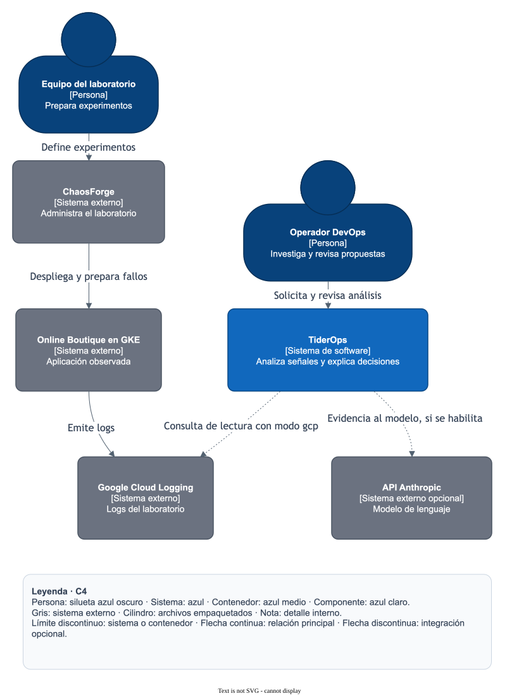

[SVG ampliable](svg/01-c4-context.svg) · [Fuente Mermaid](source/01-c4-context.mmd.txt)

1. El operador solicita un análisis y recibe hipótesis, evidencia y decisiones.
2. ChaosForge organiza los experimentos sobre Online Boutique; la consola de TiderOps analiza la evidencia disponible.
3. En el modo local, la evidencia sintética y las reglas están dentro de TiderOps. Las flechas discontinuas requieren configuración externa.

**Decisiones relacionadas:** D01: una aplicación de diagnóstico con una raíz de código. D05: el punto de entrada de la consola funciona en observación.

**Código:** [src/tider/console/settings.py](../../src/tider/console/settings.py), [src/tider/console/providers/cloud_logging.py](../../src/tider/console/providers/cloud_logging.py), [src/tider/console/analysis.py](../../src/tider/console/analysis.py).


<a id="02-c4-containers"></a>

### C4 · Nivel 2: contenedores lógicos

**¿Qué aplicaciones ejecutables forman la consola?**

La consola tiene una aplicación web que corre en el navegador y un backend Python. El backend sirve los archivos estáticos y ejecuta el grafo. Los agentes son componentes internos del backend.

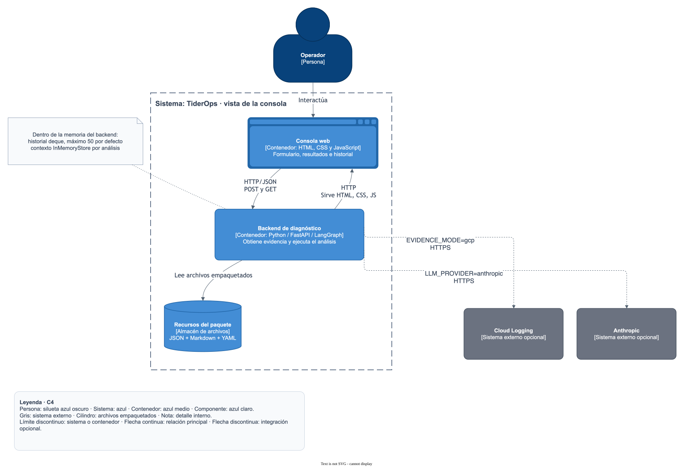

[SVG ampliable](svg/02-c4-containers.svg) · [Fuente Mermaid](source/02-c4-containers.mmd.txt)

1. El navegador se comunica por HTTP/JSON con FastAPI; el análisis se devuelve en la misma solicitud.
2. El historial y el contexto son estructuras en la memoria del backend, no servicios de base de datos separados.
3. El backend lee escenarios JSON, contexto Markdown y política YAML empaquetados. La versión de Docker despliega el mismo backend.

**Decisiones relacionadas:** D01: un paquete Python instalable y recursos incluidos en la distribución. D03: historial por aplicación y contexto por análisis.

**Código:** [src/tider/console/api.py](../../src/tider/console/api.py), [src/tider/console/static/js/app.js](../../src/tider/console/static/js/app.js), [src/tider/console/service.py](../../src/tider/console/service.py), [src/tider/console/analysis.py](../../src/tider/console/analysis.py), [pyproject.toml](../../pyproject.toml).


<a id="03-c4-components"></a>

### C4 · Nivel 3: componentes del backend

**¿Cómo se reparten las responsabilidades dentro del proceso Python?**

create_app compone el servicio, sus conectores y el motor. AnalysisService coordina el caso de uso; LabEngine adapta las señales al grafo compartido. La política y las explicaciones tienen módulos propios.

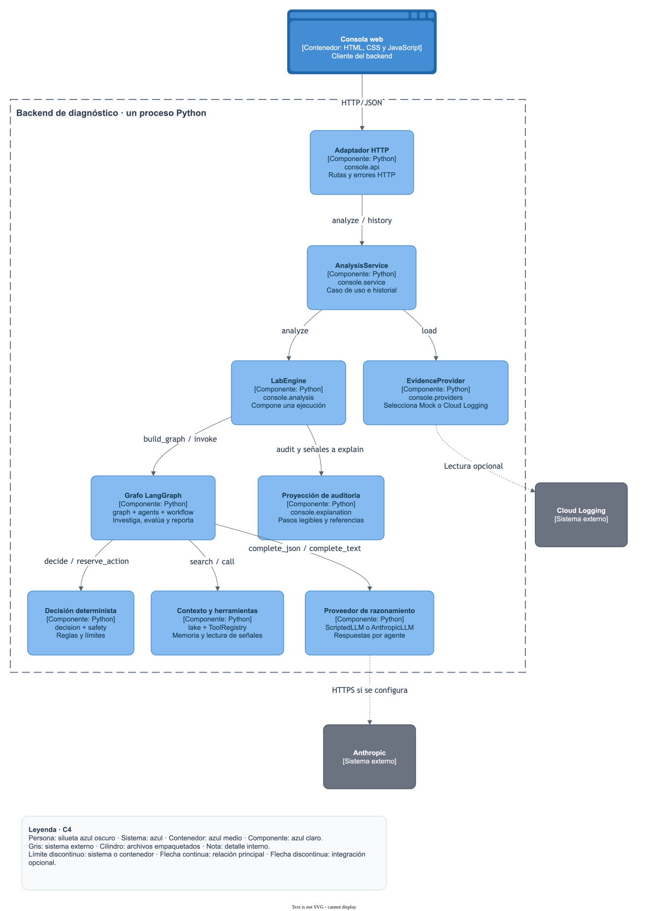

[SVG ampliable](svg/03-c4-components.svg) · [Fuente Mermaid](source/03-c4-components.mmd.txt)

1. Las flechas representan invocaciones entre componentes del mismo proceso, salvo los dos proveedores externos.
2. El servicio controla identificación, tiempo e historial. El motor configura herramientas, contexto y dependencias por ejecución.
3. El grafo utiliza agentes y nodos deterministas. explain convierte su auditoría en DecisionStep sin invocar otro modelo.

**Decisiones relacionadas:** D02: orquestación, agentes y política separados. D03: dependencias explícitas. D04: explicaciones derivadas de eventos registrados.

**Código:** [src/tider/console/api.py](../../src/tider/console/api.py), [src/tider/console/service.py](../../src/tider/console/service.py), [src/tider/console/analysis.py](../../src/tider/console/analysis.py), [src/tider/graph.py](../../src/tider/graph.py), [src/tider/console/explanation.py](../../src/tider/console/explanation.py).


<a id="04-c4-code"></a>

### C4 · Nivel 4: código del caso de uso

**¿Cómo se implementó AnalysisService sin acoplarlo a HTTP ni a un proveedor concreto?**

El caso de uso depende de dos Protocol de Python: EvidenceSource y DiagnosticEngine. Recibe sus implementaciones en el constructor. Esto permite probarlo con dobles y mantener separadas la consulta y la investigación.

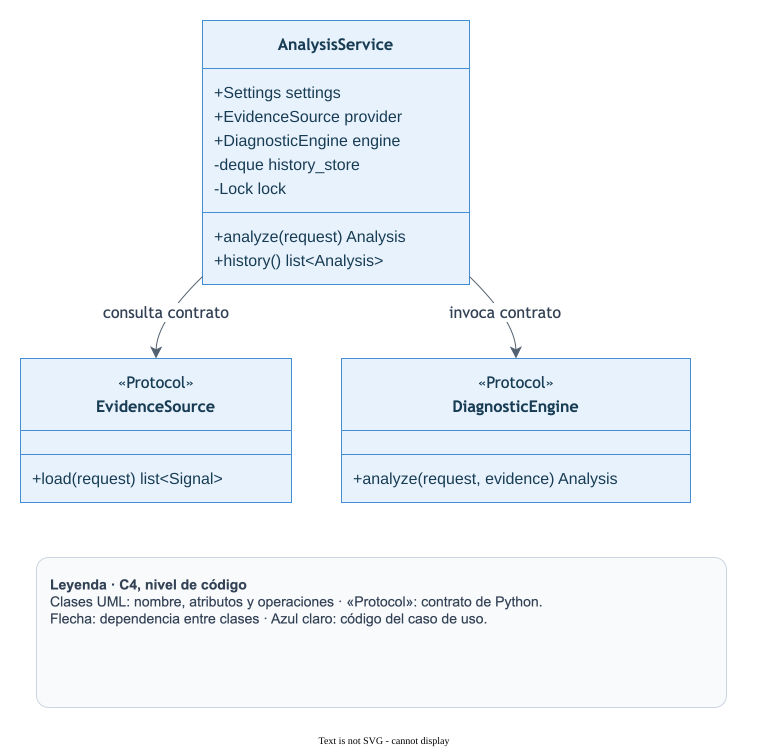

[SVG ampliable](svg/04-c4-code.svg) · [Fuente Mermaid](source/04-c4-code.mmd.txt)

1. Los Protocol declaran load y analyze. Sus implementaciones deben cumplir esas firmas; no necesitan heredar de estos contratos.
2. AnalysisService posee el historial y su Lock. Devuelve copias para que un consumidor no altere los resultados guardados.
3. create_app inyecta EvidenceProvider como EvidenceSource y LabEngine como DiagnosticEngine; sus componentes aparecen en la vista C4 de nivel 3.

**Decisiones relacionadas:** D03: inyección de dependencias y estado por aplicación. Pruebas: aislamiento de historial y análisis concurrentes.

**Código:** [src/tider/console/service.py](../../src/tider/console/service.py), [src/tider/console/providers/__init__.py](../../src/tider/console/providers/__init__.py), [src/tider/console/analysis.py](../../src/tider/console/analysis.py), [tests/console/test_service.py](../../tests/console/test_service.py).


<a id="05-sequence-analysis"></a>

### Secuencia · del formulario al resultado

**¿En qué orden ocurre un análisis completo?**

La solicitud HTTP valida la entrada, recoge evidencia y ejecuta el grafo de manera síncrona desde el punto de vista del cliente. Sólo un resultado completado se agrega al historial.

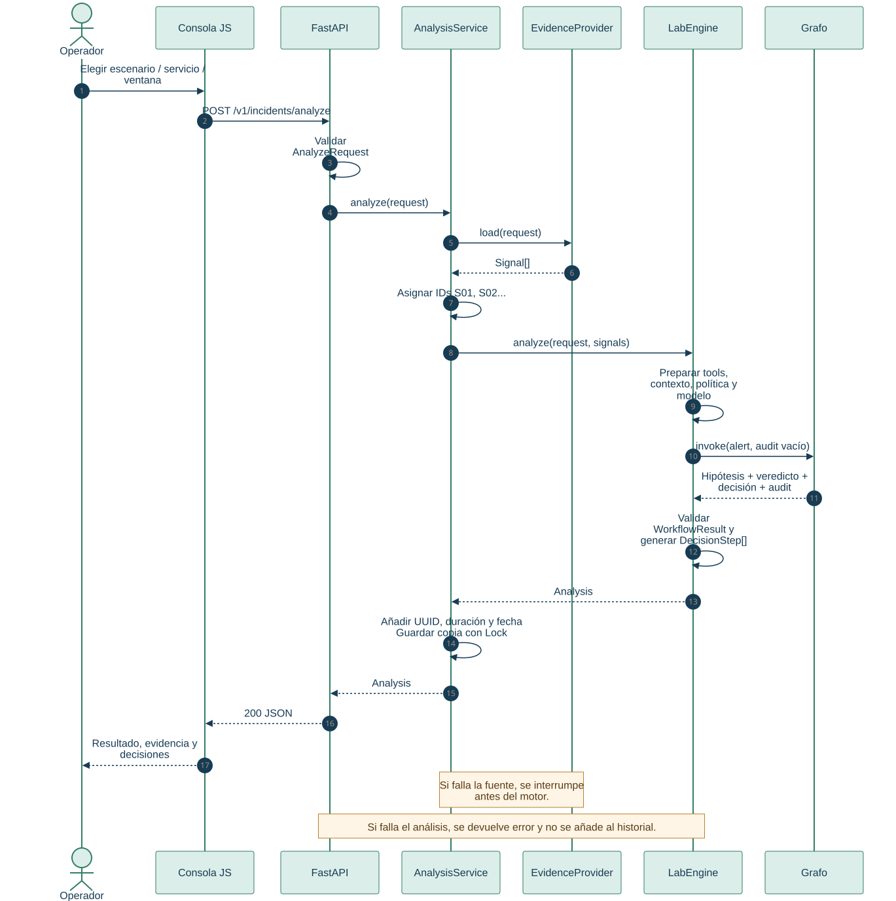

[SVG ampliable](svg/05-sequence-analysis.svg) · [Fuente Mermaid](source/05-sequence-analysis.mmd.txt)

1. La asignación de S01, S02… ocurre después de obtener las señales y antes de invocar el motor.
2. El resultado incluye la auditoría del grafo y una proyección legible; el servicio añade el identificador, la duración y la fecha.
3. Una consulta o análisis fallidos devuelve error HTTP. No se guarda un análisis exitoso ficticio en el historial.

**Decisiones relacionadas:** D03: HTTP traduce errores; el servicio coordina el análisis. D04: la vista legible deriva de la misma ejecución.

**Código:** [src/tider/console/static/js/app.js](../../src/tider/console/static/js/app.js), [src/tider/console/api.py](../../src/tider/console/api.py), [src/tider/console/service.py](../../src/tider/console/service.py), [src/tider/console/analysis.py](../../src/tider/console/analysis.py).


<a id="06-agent-workflow"></a>

### Actividad · grafo de los agentes

**¿Qué hace cada agente y cuándo se repite la investigación?**

LangGraph conecta ocho etapas. Investigador, juez y reportero usan el proveedor de razonamiento seleccionado. Recepción, recuperación, decisión y control de ejecución se implementan con código determinista.


[SVG ampliable](svg/06-agent-workflow.svg) · [Fuente Mermaid](source/06-agent-workflow.mmd.txt)

1. El investigador dispone de hasta seis pasos de herramienta por ronda. El juez incrementa el contador de rondas.
2. Se vuelve a investigar sólo si falta respaldo, hay evidencia solicitada y quedan rondas; por defecto el máximo es dos.
3. En la consola, execute apunta a preview_node: se registra una propuesta. verify queda omitido y report no aprende un incidente resuelto.

**Decisiones relacionadas:** D02: el grafo expresa transiciones y los módulos contienen el trabajo. D05: la consola elige la capacidad de observación al compilar el grafo.

**Código:** [src/tider/graph.py](../../src/tider/graph.py), [src/tider/agents/investigator.py](../../src/tider/agents/investigator.py), [src/tider/agents/judge.py](../../src/tider/agents/judge.py), [src/tider/workflow/nodes.py](../../src/tider/workflow/nodes.py), [src/tider/agents/reporter.py](../../src/tider/agents/reporter.py).


<a id="07-decision-policy"></a>

### Árbol de decisión · reglas y controles

**¿Por qué el agente propone un runbook, un cambio o revisión humana?**

La decisión final se calcula con reglas. La hipótesis propone una acción y el juez aporta respaldo y confianza. Las precondiciones operativas se leen de Evidence.data, no de texto libre.


[SVG ampliable](svg/07-decision-policy.svg) · [Fuente Mermaid](source/07-decision-policy.mmd.txt)

1. Si se propone escalar, falta respaldo o el namespace no está permitido, la ruta es revisión humana.
2. Para runbooks se comprueban umbral, deployment, protección y precondiciones. Después se reservan los límites de Safety.
3. En la consola cualquier ruta produce una propuesta; una ruta runbook no significa que se ejecutó kubectl.

**Decisiones relacionadas:** D02: el decisor es independiente del modelo. D05: autorización de una propuesta y ejecución son pasos diferentes.

**Código:** [src/tider/decision/policy.py](../../src/tider/decision/policy.py), [src/tider/decision/allowlist.yaml](../../src/tider/decision/allowlist.yaml), [src/tider/safety.py](../../src/tider/safety.py), [src/tider/workflow/nodes.py](../../src/tider/workflow/nodes.py).


<a id="08-data-contracts"></a>

### Modelo de datos · solicitud, evidencia y resultado

**¿Qué objetos viajan por la aplicación y cómo se relacionan?**

Los modelos Pydantic validan la entrada y la respuesta pública. Signal es una señal de la fuente; Evidence es el registro de una herramienta dentro del motor. Analysis reúne ambas vistas a través del resultado del flujo.


[SVG ampliable](svg/08-data-contracts.svg) · [Fuente Mermaid](source/08-data-contracts.mmd.txt)

1. Una solicitud produce un Analysis con señales, WorkflowResult y una lista ordenada de DecisionStep.
2. WorkflowResult conserva hipótesis, veredicto, decisión, ejecución, reporte y auditoría.
3. evidence_ids referencia Signal.id dentro del mismo resultado. Es una referencia lógica, no una clave de base de datos.

**Decisiones relacionadas:** D03: validación en los bordes del caso de uso. D04: contrato explícito para explicar los resultados.

**Código:** [src/tider/console/models.py](../../src/tider/console/models.py), [src/tider/state.py](../../src/tider/state.py), [src/tider/console/explanation.py](../../src/tider/console/explanation.py).


<a id="09-evidence-flow"></a>

### Flujo de datos · origen y uso de las señales

**¿Cómo se obtiene la evidencia y qué llega al razonamiento?**

El gateway selecciona el proveedor indicado. Los mocks se leen del paquete; Cloud Logging consulta una ventana y entorno acotados, selecciona mensajes y enmascara patrones antes de construir Signal.


[SVG ampliable](svg/09-evidence-flow.svg) · [Fuente Mermaid](source/09-evidence-flow.mmd.txt)

1. GCP exige habilitación en el servidor y credenciales ADC. El filtro incluye proyecto, clúster, región, namespace, tiempo y servicio/dependencias.
2. La consulta trae hasta 100 entradas por defecto, configurable hasta 200. Se admite texto directo; en payloads JSON se selecciona message, msg o error.
3. Las herramientas del laboratorio no reciben argumentos; leen las señales ya recogidas. El proveedor externo recibe esa evidencia únicamente al activar Anthropic.

**Decisiones relacionadas:** D03: conectores intercambiables con el mismo contrato. D05: elección explícita de fuentes y capacidades externas.

**Código:** [src/tider/console/providers/__init__.py](../../src/tider/console/providers/__init__.py), [src/tider/console/providers/cloud_logging.py](../../src/tider/console/providers/cloud_logging.py), [src/tider/console/providers/redaction.py](../../src/tider/console/providers/redaction.py), [src/tider/console/analysis.py](../../src/tider/console/analysis.py).


<a id="10-deployment"></a>

### Despliegue · ejecución local y Docker

**¿Dónde corre cada parte y qué se necesita para abrir la consola?**

El backend puede iniciarse con make run en el entorno virtual o como un contenedor Docker. Son dos alternativas para la misma aplicación. Los recursos del laboratorio GKE son un destino externo de consulta.


[SVG ampliable](svg/10-deployment.svg) · [Fuente Mermaid](source/10-deployment.mmd.txt)

1. El arranque nativo escucha en 127.0.0.1:8080. El navegador utiliza esa dirección para la consola y la API.
2. Compose publica 127.0.0.1:8080 hacia el puerto 8080 del contenedor, cuyo usuario de ejecución es tiderops.
3. El perfil lake inicia Postgres/pgvector para la entrada operativa del motor. La consola no está conectada a ese servicio.

**Decisiones relacionadas:** D01: misma distribución y versiones fijadas para ejecución nativa y contenedor. D05: acceso a GCP opcional; no se despliega un agente por cada nodo del grafo.

**Código:** [Makefile](../../Makefile), [Dockerfile](../../Dockerfile), [docker-compose.yml](../../docker-compose.yml), [src/tider/console/__main__.py](../../src/tider/console/__main__.py), [src/tider/api.py](../../src/tider/api.py).


<a id="11-module-dependencies"></a>

### Dependencias · mapa del código

**¿Qué archivo debo cambiar para modificar una función del sistema?**

La organización separa la presentación, el caso de uso, los adaptadores del laboratorio y el motor compartido. Las flechas indican dependencias principales de implementación; no son llamadas de red.


[SVG ampliable](svg/11-module-dependencies.svg) · [Fuente Mermaid](source/11-module-dependencies.mmd.txt)

1. Los módulos JS se separan en interacción, HTTP y renderizado. FastAPI contiene las rutas y la composición del servicio.
2. La lógica de diagnóstico por reglas está en baseline.py; las instrucciones de agentes están en prompts.py; los permisos de acciones están en decision/.
3. Las pruebas de consola y del motor se ejecutan juntas, usando el paquete instalado.

**Decisiones relacionadas:** D01: raíz canónica en project/code/tider. D02: separar módulos por responsabilidad, sin otro orquestador.

**Código:** [src/tider/console/static/js/app.js](../../src/tider/console/static/js/app.js), [src/tider/console/api.py](../../src/tider/console/api.py), [src/tider/console/analysis.py](../../src/tider/console/analysis.py), [src/tider/graph.py](../../src/tider/graph.py), [src/tider/agents/prompts.py](../../src/tider/agents/prompts.py).


<a id="12-implementation-decisions"></a>

### Implementación · de la estructura anterior a la actual

**¿Qué se reorganizó y qué problema resolvió cada cambio?**

La reorganización absorbió la consola en el repositorio del motor y separó los puntos que mezclaban responsabilidades. El objetivo fue hacer localizables las decisiones, los contratos y las pruebas.


[SVG ampliable](svg/12-implementation-decisions.svg) · [Fuente Mermaid](source/12-implementation-decisions.mmd.txt)

1. El proyecto pasó de dos raíces conectadas por PYTHONPATH a un paquete con pyproject.toml y uv.lock.
2. main.py se repartió entre API y caso de uso; evidence.py entre conectores y datos de escenarios; el grafo conserva sólo su construcción y punto de entrada.
3. La auditoría JSON sigue disponible, pero ahora la interfaz también presenta DecisionStep con motivos e identificadores de señales.

**Decisiones relacionadas:** D01: un paquete. D02: flujo y agentes separados. D03: composición explícita. D04: explicación derivada de eventos.

**Código:** [docs/decisions.md](../../docs/decisions.md), [pyproject.toml](../../pyproject.toml), [src/tider/console/service.py](../../src/tider/console/service.py), [src/tider/console/explanation.py](../../src/tider/console/explanation.py), [tests/console/test_service.py](../../tests/console/test_service.py).


<a id="13-analysis-states"></a>

### Estados · ciclo de una solicitud

**¿Qué significa que un análisis terminó, necesita evidencia o falló?**

Esta vista describe el ciclo de procesamiento. Sólo hypothesis e insufficient_evidence son valores del campo Analysis.status. Las otras cajas representan etapas o respuestas HTTP, no estados persistidos en una base de datos.


[SVG ampliable](svg/13-analysis-states.svg) · [Fuente Mermaid](source/13-analysis-states.mmd.txt)

1. Una entrada inválida termina con 422; una configuración no permitida puede terminar con 400; un fallo de fuente o motor termina con 503.
2. Un análisis completado puede contener una hipótesis respaldada o evidencia insuficiente. Ambos pueden guardarse en el historial.
3. En observación, completar el análisis no marca el incidente como resuelto: workflow.resolved permanece false.

**Decisiones relacionadas:** D03: errores y resultados exitosos tienen caminos separados. D04: la UI conserva el significado del resultado del motor.

**Código:** [src/tider/console/models.py](../../src/tider/console/models.py), [src/tider/console/api.py](../../src/tider/console/api.py), [src/tider/console/service.py](../../src/tider/console/service.py), [src/tider/console/analysis.py](../../src/tider/console/analysis.py).

## Editar en draw.io

**[TiderOps_Arquitectura.drawio](TiderOps_Arquitectura.drawio)** contiene las 13 vistas
en páginas separadas. Abrirlo con la aplicación draw.io; cada figura, texto y
conector se puede editar. Las pestañas están numeradas del 01 al 13. Cada página
incluye su explicación y referencias al código.

Este archivo es el entregable editable. Las cuatro vistas previas C4 se exportan
desde él con `scripts/render_diagrams.py --sync-c4 --skip-render`. Una edición manual
en draw.io requiere repetir esa exportación para actualizar la galería.

La conversión inicial usa el importador nativo de draw.io Desktop 32.4.1. El script
`scripts/export_drawio.py` permite repetirla desde las fuentes conservadas y se
detiene si el archivo de destino ya existe. Para crear otra copia sin sobrescribir
las ediciones manuales, indicar `--output` con una ruta nueva:

```bash
.venv/bin/python scripts/export_drawio.py --output /tmp/TiderOps_Arquitectura.drawio
```

## Fuentes y vistas previas

Los archivos `source/*.mmd.txt` son las fuentes editables de Mermaid.
`catalog.json` mantiene las explicaciones y enlaces; `svg/` e `index.html` son las
salidas para leer, compartir o insertar en documentos. Cada SVG se puede ampliar
sin perder calidad. La galería funciona sin conexión a Internet.

El sufijo `.mmd.txt` mantiene los diagramas de desarrollo fuera del lector de
topología operativa, que incorpora archivos `.mmd` y `.mermaid`. Esta guía lleva
el tipo `guide` y no añade aristas al contexto del motor.

Instalar Mermaid CLI en una carpeta temporal y regenerar desde la raíz del proyecto:

```bash
npm install --prefix /tmp/tider-diagram-tools --no-audit --no-fund @mermaid-js/mermaid-cli@11.12.0
.venv/bin/python scripts/render_diagrams.py --mmdc /tmp/tider-diagram-tools/node_modules/.bin/mmdc
```

Si se utiliza un Chrome ya instalado, añadir `--chrome` con la ruta de su ejecutable.
Para actualizar sólo la guía y la galería a partir de SVG existentes, usar
`--skip-render`. El script valida rutas, catálogo y XML de todos los SVG antes de
generar la documentación. No instala dependencias dentro del proyecto.

## Referencias de la notación

El [modelo C4](https://c4model.com/diagrams) define las cuatro escalas principales.
La [vista de contenedores](https://c4model.com/diagrams/container) separa aplicaciones
y almacenes; la [vista de código](https://c4model.com/diagrams/code) desarrolla un
componente. El render utiliza [Mermaid CLI](https://github.com/mermaid-js/mermaid-cli).
Las relaciones y decisiones de este catálogo se contrastaron con los archivos
del proyecto enlazados en cada vista.
