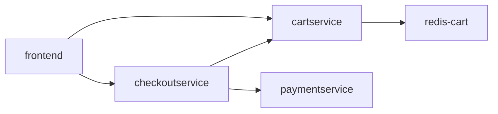

# Online Boutique

Proyecto tider-ops, clúster chaosforge-lab, región us-central1, namespace boutique.
Frontend llama a cartservice; cartservice utiliza redis-cart. Checkout llama a
cartservice, paymentservice y shippingservice. Redis indisponible y cartservice
sin endpoints son fallas distintas. Comprobar logs, réplicas, readiness y endpoints
antes de proponer una intervención. La consola sólo presenta el diagnóstico.

